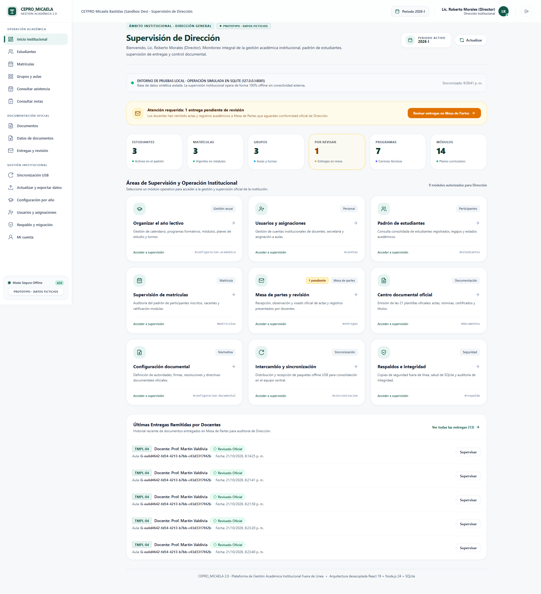
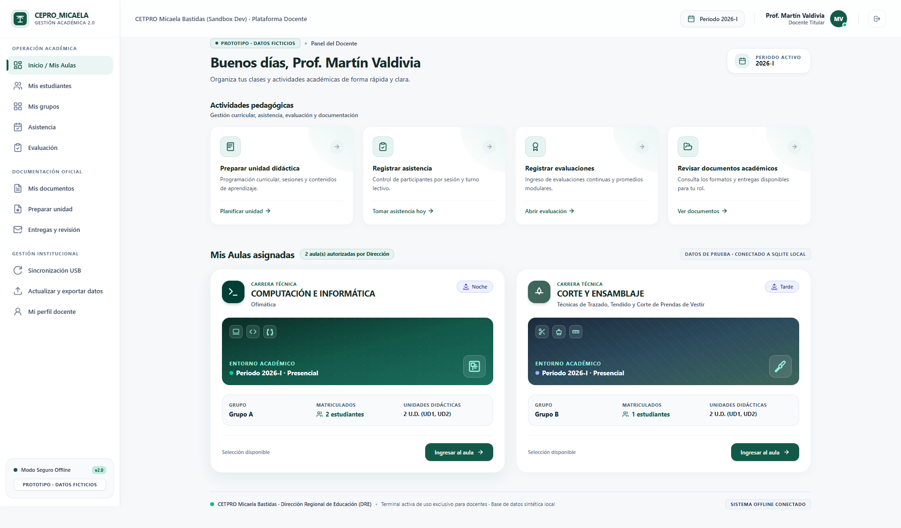
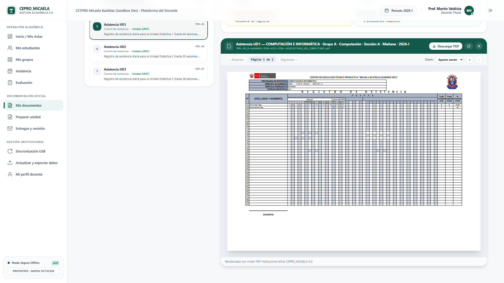
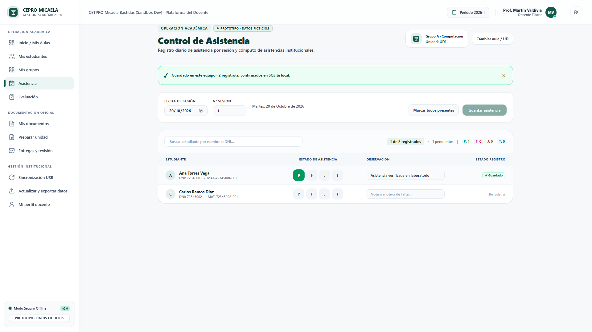
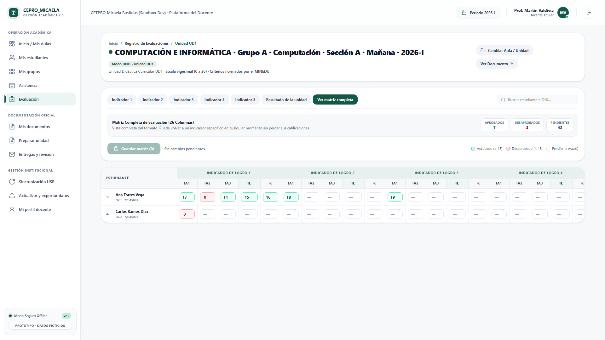
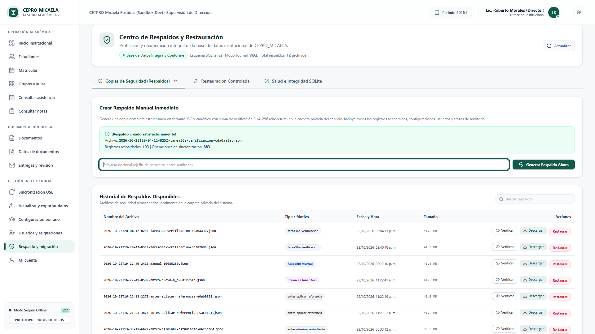
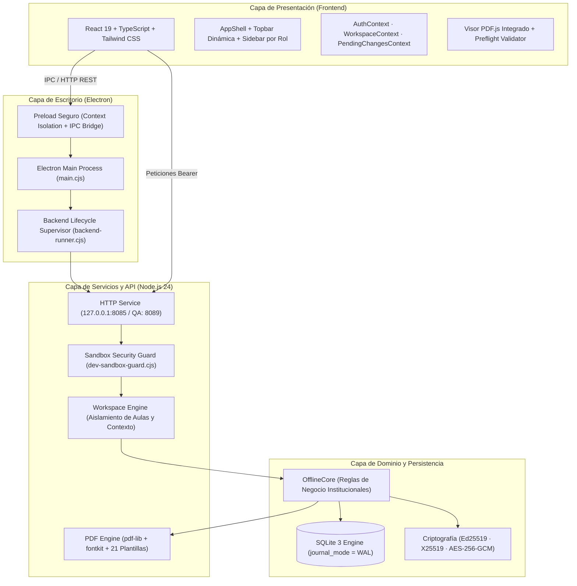

# CEPRO_MICAELA 2.0
### Sistema Académico Institucional de Gestión Técnico-Productiva y Emisión Documental Normada
#### CETPRO Micaela Bastidas · Plataforma Offline-First para Windows

---

[](https://nodejs.org/)
[](https://react.dev/)
[](https://www.typescriptlang.org/)
[](https://www.electronjs.org/)
[](https://tailwindcss.com/)
[](https://www.sqlite.org/)
[](#garantía-de-calidad-y-pruebas-automatizadas)
[](#seguridad-y-cumplimiento-normativo)
[-0078D6?logo=windows&logoColor=white)](#instalador-y-distribución-windows)

---

## 1. DESCRIPCIÓN GENERAL

**CEPRO_MICAELA 2.0** es una solución integral de escritorio y entorno web local diseñada específicamente para el **Centro de Educación Técnico-Productiva (CETPRO) Micaela Bastidas**. 

El sistema responde a las exigencias operativas y pedagógicas del Ministerio de Educación del Perú (MINEDU), permitiendo la administración exhaustiva de programas formativos, gestión modular de matrículas, registro de asistencia por sesiones, evaluación continua en escala vigesimal (0-20), visado administrativo de entregas y la **emisión binaria exacta de las 21 plantillas oficiales de documentación académica**.

### Principios Fundamentales
- **100% Offline-First:** Opera de manera completamente autónoma sin requerir conectividad a Internet ni depender de servicios en la nube.
- **Integridad Transaccional y Concurrencia:** Motor SQLite nativo en modo WAL con detección y resolución determinista de conflictos (HTTP 409) mediante control de versiones (`rev`).
- **Seguridad y Criptografía Institucional:** Respaldo completo cifrado con **AES-256-GCM**, paquetes de sincronización descentralizada firmados con **Ed25519/X25519** e inspección de integridad referencial.
- **Aislamiento Estricto para Desarrollo:** Guardián de seguridad en dos capas (`dev-sandbox-guard`) que bloquea cualquier acceso o fuga hacia datos institucionales reales.

---

## 2. GALERÍA VISUAL DEL SISTEMA

### Panel de Control de Dirección (Supervisión Global)
Supervisión centralizada de matrícula institucional, cobertura curricular, salud de la base de datos y alertas de sincronización.


### Dashboard Docente & Selección de Aula de Trabajo
Acceso contextualizado exclusivamente a las aulas asignadas, con navegación ágil entre unidades didácticas y modos modular/unidad.


### Centro Documental Oficial & Visor PDF Integrado
Catálogo normado de 21 plantillas con validación Preflight previa, motor nativo PDF.js, soporte multipágina y sellos de seguridad (*BORRADOR* / *DEMOSTRACIÓN*).


### Registro de Asistencia por Sesiones y Resolución de Conflictos
Calendario académico normado con feriados nacionales (noviembre 2026), estados P/F/J/T y resolución segura de concurrencia.


### Matriz de Evaluación Continua (Escala Vigesimal 0-20)
Ingreso masivo por teclado, validación vigesimal estricta, diferenciación entre calificación `0` y estado `pendiente`, y cálculo de logro de unidad.


### Respaldo Institucional Cifrado y Sincronización Descentralizada USB
Exportación de bases con cifrado AES-256-GCM con clave maestra, preflight de verificación SHA-256 e intercambio de paquetes firmado sin Internet.


---

## 3. ARQUITECTURA DEL SISTEMA

El sistema implementa una arquitectura desacoplada en capas que garantiza alta cohesión, bajo acoplamiento y portabilidad entre entornos web y escritorio:



---

## 4. MATRIZ DE MÓDULOS Y CONTROL DE ACCESO (RBAC)

El acceso a las funcionalidades está rigurosamente delimitado por la política institucional de roles:

| Módulo | Director | Secretaría | Docente | Descripción Funcional |
| :--- | :---: | :---: | :---: | :--- |
| **Dashboard Ejecutivo** | :white_check_mark: Completo | :white_check_mark: Académico | :white_check_mark: Pedagógico | Métricas consolidadas, estado institucional, accesos rápidos y salud SQLite. |
| **Gestión de Estudiantes** | :white_check_mark: Total | :white_check_mark: Registro/Edición | :lock: Solo lectura aula | Padrón unificado de participantes, historial documental y archivado formal. |
| **Gestión de Matrículas** | :white_check_mark: Total | :white_check_mark: Registro/Retiro | :lock: Solo lectura aula | Código normado `MAT-DNI-001`, regularización modular (EXCLUDE/RESTORE) y traslados. |
| **Aulas y Grupos** | :white_check_mark: Total | :lock: Bloqueado (403) | :lock: Bloqueado (403) | Alta de aulas, configuración de turnos, unidades didácticas, cierre y reapertura formal. |
| **Registro de Asistencia** | :white_check_mark: Supervisión | :white_check_mark: Supervisión | :white_check_mark: Operativo | Control diario por sesiones (P/F/J/T), justificaciones y manejo de concurrencia 409. |
| **Registro de Evaluaciones** | :white_check_mark: Supervisión | :white_check_mark: Supervisión | :white_check_mark: Operativo | Escala 0-20, criterios de evaluación IA/IL, notas de recuperación y logro final. |
| **Centro Documental** | :white_check_mark: 21 Plantillas | :white_check_mark: 21 Plantillas | :white_check_mark: Asignadas | Emisión binaria PDF de las 21 plantillas con validación Preflight en tiempo real. |
| **Entregas y Visado** | :white_check_mark: Revisión/Visado | :white_check_mark: Recepción | :white_check_mark: Envío borrador | Ciclo normado: Borrador :arrow_right: Presentado :arrow_right: Observado / Recibido :arrow_right: Revisado (Director). |
| **Configuración Curricular** | :white_check_mark: Total | :white_check_mark: Grupos | :lock: Bloqueado (403) | Períodos lectivos, programas de estudio, módulos formativos y clonación auditada. |
| **Gestión de Usuarios** | :white_check_mark: Total | :white_check_mark: Docentes | :lock: Bloqueado (403) | Cuentas institucionales, auditoría de accesos y asignaciones docentes a grupos. |
| **Respaldo Institucional** | :white_check_mark: Exclusivo | :lock: Bloqueado (403) | :lock: Bloqueado (403) | Exportación cifrada AES-256-GCM, verificación de sumas SHA-256 y restauración. |
| **Sincronización USB** | :white_check_mark: Total | :white_check_mark: Total | :white_check_mark: Aulas asignadas | Intercambio de paquetes cifrados sin Internet con reconciliación de operaciones. |

---

## 5. CATÁLOGO OFICIAL DE PLANTILLAS DOCUMENTALES (MINEDU)

El motor PDF genera binarios puros (%PDF-) para las 21 plantillas oficiales calibradas milimétricamente:

<details>
<summary><b>Haz clic aquí para desplegar las 21 plantillas oficiales</b></summary>

| Código | Denominación Oficial del Documento | Ámbito / Nivel | Orientación | Formato |
| :--- | :--- | :--- | :--- | :--- |
| **TMPL-01** | Nómina de Matrícula Oficial | Institucional / Modular | Horizontal | A4 |
| **TMPL-02** | Ficha Individual de Matrícula | Participante | Vertical | A4 |
| **TMPL-03** | Registro Consolidado de Matrícula Modular | Modular | Horizontal | A4 |
| **TMPL-04** | Portada del Registro de Asistencia y Evaluación | Aula / Período | Vertical | A4 |
| **TMPL-05** | Registro de Control de Asistencia — Unidad 1 | Unidad Curricular | Horizontal | A3 |
| **TMPL-06** | Registro de Control de Asistencia — Unidad 2 | Unidad Curricular | Horizontal | A3 |
| **TMPL-07** | Registro de Control de Asistencia — Unidad 3 | Unidad Curricular | Horizontal | A3 |
| **TMPL-08** | Registro de Control de Asistencia — Unidad 4 | Unidad Curricular | Horizontal | A3 |
| **TMPL-09** | Registro de Control de Asistencia — Unidad 5 | Unidad Curricular | Horizontal | A3 |
| **TMPL-10** | Registro de Control de Asistencia — Unidad 6 | Unidad Curricular | Horizontal | A3 |
| **TMPL-11** | Registro de Evaluación del Aprendizaje — Unidad 1 | Unidad Curricular | Horizontal | A3 |
| **TMPL-12** | Registro de Evaluación del Aprendizaje — Unidad 2 | Unidad Curricular | Horizontal | A3 |
| **TMPL-13** | Registro de Evaluación del Aprendizaje — Unidad 3 | Unidad Curricular | Horizontal | A3 |
| **TMPL-14** | Registro de Evaluación del Aprendizaje — Unidad 4 | Unidad Curricular | Horizontal | A3 |
| **TMPL-15** | Registro de Evaluación del Aprendizaje — Unidad 5 | Unidad Curricular | Horizontal | A3 |
| **TMPL-16** | Registro de Evaluación del Aprendizaje — Unidad 6 | Unidad Curricular | Horizontal | A3 |
| **TMPL-17** | Consolidado de Evaluación y Registro de EFSRT | Módulo / Prácticas | Horizontal | A3 |
| **TMPL-18** | Acta Consolidada de Evaluación del Aprendizaje | Módulo Formal | Vertical | A4 |
| **TMPL-19** | Registro Consolidado de Actas de Evaluación | Anual / Histórico | Vertical | A4 |
| **TMPL-20** | Certificado Modular Oficial de Competencias | Estudiante / Módulo | Vertical | A4 |
| **TMPL-21** | Título de Técnico / Auxiliar Técnico | Institucional / MINEDU | Horizontal | A4 Especial |

</details>

---

## 6. INSTALACIÓN Y PUESTA EN MARCHA

### Requisitos Previos
- **Sistema Operativo:** Windows 10 o Windows 11 (64-bit).
- **Node.js:** Versión 24.0.0 o superior instalada.
- **npm:** Versión 10.0.0 o superior.

### 1. Clonar el Repositorio
```bash
git clone https://github.com/whangedax/CEPRO_MICAELA.git
cd CEPRO_MICAELA
```

### 2. Instalar Dependencias
```bash
npm install
```

### 3. Inicializar el Sandbox Sintético de Desarrollo
Configura la base de datos de desarrollo con datos sintéticos oficiales, directores, docentes, secretaría y aulas de prueba:
```bash
npm run dev:init-sandbox
```

### 4. Ejecución en Modo Desarrollo (Navegador Web)
Inicia concurrentemente el servidor backend en `http://127.0.0.1:8085` y el servidor de desarrollo Vite:
```bash
npm run dev:all
```
Abre tu navegador en `http://localhost:5173`.

### 5. Ejecución en Modo Escritorio (Electron)
Inicia la aplicación de escritorio nativa con Electron:
```bash
npm run electron:dev
```

### 6. Compilación de Producción
Compila y valida tipos TypeScript con empaquetado optimizado mediante Vite:
```bash
npm run build
```

---

## 7. CREDENCIALES DEL SANDBOX DE DESARROLLO

El entorno sintético incluye tres perfiles normados preconfigurados para pruebas locales:

| Rol | Usuario | Contraseña | Asignaciones y Permisos |
| :--- | :--- | :--- | :--- |
| **DIRECTOR** | `director.dev` | `DirectorDev2026!` | Acceso irrestricto, supervisión global, respaldo cifrado y visado final. |
| **SECRETARIA** | `secretaria.dev` | `SecretariaDev2026!` | Gestión completa de matrículas, estudiantes, recepción y parámetros de grupo. |
| **DOCENTE** | `docente.dev` | `DocenteDev2026!` | Titular de *Grupo A · Computación* y *Grupo B · Confección Textil*. |

---

## 8. GARANTÍA DE CALIDAD Y PRUEBAS AUTOMATIZADAS

El proyecto cuenta con una infraestructura de aseguramiento de la calidad automatizada con **aislamiento estricto**:

```bash
npm run test:sandbox
```

### Características de la Suite QA:
- **Base de Datos Desechable:** Las pruebas se ejecutan sobre `dev-sandbox/data/qa-isolated` en el puerto `8089`, garantizando que la base de datos principal de trabajo (`dev-sandbox/data/cetpro.sqlite`) **nunca sea alterada** (0 bytes modificados, hash SHA-256 idéntico antes y después de las pruebas).
- **125 Pruebas Automatizadas (100% PASS):**

```
========================================================================
  RESULTADO: TODAS LAS PRUEBAS QA SE EJECUTARON SATISFACTORIAMENTE
========================================================================
  ✔ dev-sandbox-guard.test.cjs               (17 tests)  — 100% PASS
  ✔ backend-integration.test.cjs            (18 tests)  — 100% PASS
  ✔ attendance-module.test.cjs               (8 tests)   — 100% PASS
  ✔ pending-changes-and-conflict.test.cjs    (5 tests)   — 100% PASS
  ✔ grades-module.test.cjs                   (9 tests)   — 100% PASS
  ✔ documents-module.test.cjs                (10 tests)  — 100% PASS
  ✔ document-watermark-security.test.cjs     (10 tests)  — 100% PASS
  ✔ document-config.test.cjs                 (12 tests)  — 100% PASS
  ✔ document-submissions.test.cjs            (15 tests)  — 100% PASS
  ✔ dashboards-role.test.cjs                (10 tests)  — 100% PASS
  ✔ students-enrollments-groups.test.cjs    (14 tests)  — 100% PASS
------------------------------------------------------------------------
  TOTAL: 125 pruebas aprobadas | 0 fallos | 0 omitidos
========================================================================
```

---

## 9. EMPAQUETADOR E INSTALADOR WINDOWS

El sistema incluye scripts automatizados para generar el paquete de distribución para Windows mediante **Inno Setup**:

```bash
# Empaquetar la aplicación de Electron
npm run electron:pack

# Construir el instalador standalone de Windows
npm run installer:build
```

El script genera `CEPRO_MICAELA_2.0_Setup_v2.0.1_QA_x64.exe`, que instala la aplicación en `%LocalAppData%\Programs\CEPRO_MICAELA_2.0`, crea accesos directos en el Escritorio y Menú Inicio, y asocia el desinstalador limpio en el Panel de Control.

---

## 10. ESTRUCTURA DEL PROYECTO

```text
C:\CETPRO\CETPRO_MODERNIZACION_V2
├── .agents/                 # Reglas y directivas de ingeniería multiagente
├── capturas_ux_informe2/    # Evidencia fotográfica de validación visual responsive
├── electron/                # Punto de entrada de Electron (main, preload, backend runner)
├── informes_senati/         # Reportes técnicos oficiales de práctica SENATI (HTML/DOCX/PDF)
├── scripts/                 # Infraestructura backend y herramientas operativas
│   ├── dev-sandbox-guard.cjs       # Guardián de seguridad y aislamiento SQLite
│   ├── init-dev-sandbox.cjs        # Inicializador de datos sintéticos oficiales
│   ├── offline-core.cjs            # Motor de dominio institucional y persistencia
│   ├── offline-http.cjs            # Servidor HTTP REST loopback
│   ├── offline-pdf.cjs             # Motor de renderizado binario de las 21 plantillas
│   ├── run-dev-all.cjs             # Orquestador concurrente de desarrollo
│   ├── run-qa-tests.cjs            # Runner automatizado de pruebas en sandbox QA aislado
│   └── build-installer.cjs         # Pipeline de compilación de instalador Inno Setup
├── src/                     # Código fuente de la interfaz React 19
│   ├── api/                 # Cliente HTTP fuertemente tipado
│   ├── components/          # Componentes visuales atómicos, AppShell, Topbar, Sidebar
│   ├── context/             # Contextos de Autenticación, Workspace y Cambios Pendientes
│   ├── pages/               # Páginas completas por cada módulo institucional
│   └── utils/               # Utilitarios de calendario y metadatos de plantillas
├── tests/                   # 11 suites de pruebas automatizadas y helpers QA
├── installer.iss            # Script maestro de compilación para Inno Setup 6
├── package.json             # Manifiesto de dependencias y scripts de ejecución
├── tailwind.config.js       # Tokens de diseño y paleta institucional
├── tsconfig.json            # Configuración estricta de compilador TypeScript
└── vite.config.ts           # Configuración de compilador y empaquetador Vite
```

---

## 11. SEGURIDAD Y CUMPLIMIENTO NORMATIVO

1. **Aislamiento de Entornos:**
   - Prohibición estricta de acceso a carpetas institucionales reales (`private-data/` o repositorios originales) durante desarrollo y pruebas.
   - Detección y rechazo de enlaces simbólicos y *Junctions NTFS* maliciosos.
2. **Criptografía de Respaldo:**
   - Algoritmo **AES-256-GCM** autenticado con derivación de clave **PBKDF2** (100,000 iteraciones, SHA-256).
   - Verificación de integridad mediante suma de comprobación criptográfica **SHA-256**.
3. **Firmas Digitales de Operación:**
   - Paquetes de intercambio auditados mediante firmas digitales **Ed25519** y encapsulamiento de clave efímera **X25519**.

---

## 12. GOBERNANZA Y CRÉDITOS

- **Institución:** CETPRO Micaela Bastidas (Arequipa, Perú).
- **Entidad Formativa:** SENATI — Escuela Superior de Tecnología.
- **Desarrollador / Practicante:** Gonzalo Guzmán.
- **Repositorio Oficial:** [whangedax/CEPRO_MICAELA](https://github.com/whangedax/CEPRO_MICAELA)
- **Ramas Principales:** `main` / `master` (Estables) | `dev-gonzalo` (Desarrollo).

---
*CEPRO_MICAELA 2.0 — Modernización Tecnológica para la Educación Técnico-Productiva.*
