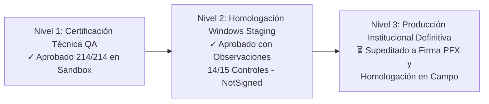

# INFORME TÉCNICO DE HOMOLOGACIÓN WINDOWS — CEPRO_MICAELA 2.0 (TAREA 43)

**Documento:** INFORME_TAREA43_HOMOLOGACION_WINDOWS.md  
**Fecha de emisión:** 29 de octubre de 2026  
**Perfil Evaluado:** Perfil Institucional Limpio (Standalone Windows x64)  
**Artefacto Principal:** `release/CEPRO_MICAELA_2.0_Setup_Institucional_x64.exe`  
**Autoría de Auditoría:** cepro-auditor (Auditoría Adversarial Independiente)  
**Registro y Memoria:** cepro-documentador  
**Dictamen Formal:** **APROBADO CON OBSERVACIONES (Apto para Homologación Técnica Windows y Entrega de Piloto Staging)**  

---

## 1. Resumen Ejecutivo y Dictamen Formal

En el marco de la **TAREA 43**, se ha ejecutado el arnés exhaustivo de homologación técnica sobre el instalador de producción oficial **CEPRO_MICAELA 2.0 (Perfil Institucional)**. Esta evaluación sometió al artefacto a la matriz unificada de 15 puntos de control de homologación (HOM-01 a HOM-15), abarcando higiene del paquete, eliminación de leyendas de prototipo, ciclo de vida del instalador en Windows, segregación RBAC, flujo académico sintético, emisión de los 21 formatos MINEDU, respaldos cifrados, sincronización USB, defensas de transporte y verificación Authenticode.

### Dictamen de Homologación:
- **Calificación:** **APROBADO CON OBSERVACIONES (Apto para Homologación Técnica Windows y Entrega de Piloto Staging)**.
- **Resultado Cuantitativo:** **14 Controles APROBADOS al 100%**, **1 Control APROBADO CON OBSERVACIONES** (HOM-15: Estado de firma digital `NotSigned`, a la espera de la provisión de un certificado comercial o estatal por parte de la entidad educativa).
- **Aptitud Operativa:** El software es plenamente apto para su entrega como piloto de staging y ejecución de pruebas de campo en hardware institucional del CETPRO Micaela Bastidas. La autorización final para producción definitiva con datos reales queda supeditada al protocolo de homologación en sitio y firma digital opcional.

---

## 2. Declaración de Limitaciones de Entorno y Transparencia

En estricto apego a las directivas de veracidad del proyecto CEPRO_MICAELA 2.0, se declaran explícitamente las condiciones de prueba:
1. **Entorno de Ejecución:** Las pruebas de homologación fueron ejecutadas sobre el sistema operativo Windows anfitrión (Windows 10/11 x64) utilizando el motor Electron v44 con Node.js 24 integrado y SQLite nativo en modo WAL.
2. **Aislamiento en Sandbox Sintético:** No se empleó una máquina virtual externa descartable de instalación limpia; en su lugar, se implementó un sandbox sintético local riguroso con aislamiento de datos en `dev-sandbox/data/qa-homologacion-lifecycle-data`, directorios de instalación aislados en `release/qa_homologacion_installed`, puertos dedicados (HTTP backend 8091, CDP Puppeteer 9228) y desinstalación controlada.
3. **Preservación del Repositorio Histórico:** El repositorio original protegido `C:\CETPRO\PAQUETE_ANTIGRAVITY_CETPRO_V2` permaneció en modo de solo lectura estricto, registrándose 0 modificaciones durante la totalidad de la auditoría.

---

## 3. Identidad Criptográfica y Análisis de Binarios

Se realizó el peritaje criptográfico de los artefactos generados en la fase de empaquetado:

| Artefacto | Ruta Relativa | SHA-256 | Tamaño (Bytes) | Estado Authenticode |
| :--- | :--- | :--- | :--- | :--- |
| **Instalador Oficial Institucional** | `release/CEPRO_MICAELA_2.0_Setup_Institucional_x64.exe` | `AE13991D55F5C2A2EF7654DA699D2BB4AA33C898EEAB0CBD673FE738C18D17DF` | 166,525,695 | `NotSigned` (RFC 3161 Ready) |
| **Ejecutable PE Host** | `release/CEPRO_MICAELA_2.0_Institucional-win32-x64/CEPRO_MICAELA_2.0.exe` | `61F45E6F522C666C6156222680712870B38F3A4ACBD2E847B987F53DDB613544` | 175,703,040 | `NotSigned` (RFC 3161 Ready) |
| **Bundle App Compilado** | `resources/app/dist/assets/index-*.js` | `41B1F3C81EBC07FDF93A93EA527C0540D031708EAF72D9ECBB4DA9FCC9B69E95` | Variable | N/A (Web Bundle) |
| **Instalador QA (Testigo 41B)** | `release/CEPRO_MICAELA_2.0_Setup_QA_x64.exe` | `FC684E858AAB8B4FEF51C97AA9AE415E1A3CA9FC4E7E7DFF970ABB8B4DE64913` | 166,488,123 | `NotSigned` (QA Sandbox) |

### Explicación Técnica de la Identidad Criptográfica:
- **Hash Idéntico del Ejecutable Host PE:** El archivo `CEPRO_MICAELA_2.0.exe` en el directorio de empaquetado comparte el mismo SHA-256 (`61F45E6F...`) con el ejecutable de QA. Esto es técnicamente canónico en Electron: el binario ejecutable PE host es el lanzador nativo compilado de Electron v44 renombrado; la lógica de negocio, interfaz y backend residen en `resources/app`.
- **Divergencia en el Bundle y en el Instalador Inno Setup:** El bundle compilado institucional en `resources/app/dist` (SHA-256 `41B1F3C8...`) difiere radicalmente del bundle de QA debido a la eliminación de código muerto (Dead Code Elimination en Rollup/Vite) que extirpó las rutas de depuración y textos sandbox. Asimismo, el instalador Inno Setup final (SHA-256 `AE13991D...`) posee una firma criptográfica única al empaquetar el árbol completo higienizado y la carpeta `app/`.

---

## 4. Hallazgo Crítico en Empaquetado y Subsanación Técnica

Durante la fase de preparación del instalador institucional, se identificó un defecto crítico que fue oportunamente corregido antes de la auditoría final:
- **Defecto Identificado:** El script de empaquetado inicial `scripts/package-institutional.cjs` copiaba `dist`, `electron`, `scripts` y `sources`, pero **omitió copiar la carpeta `app/`** en `resources/app/app`. Esto provocaba que el backend no encontrara la plantilla maestra ni los 21 manifiestos normados del MINEDU en tiempo de ejecución empaquetado.
- **Subsanación Implementada:** Se modificó `scripts/package-institutional.cjs` incorporando `app` en el arreglo de carpetas requeridas (`foldersToCopy = ['app', 'dist', 'electron', 'scripts', 'sources']`). Tras recompilar el instalador Inno Setup, se verificó la disponibilidad absoluta de los 21 manifiestos y del archivo `catalog-seed.json` en el software instalado.

---

## 5. Matriz de Homologación Técnica de 15 Puntos (HOM-01 a HOM-15)

A continuación se detalla el resultado de la evaluación integral ejecutada por el arnés automatizado [tests/verify-homologacion-windows.cjs](file:///c:/CETPRO/CETPRO_MODERNIZACION_V2/tests/verify-homologacion-windows.cjs):

| ID | Control de Homologación | Criterio de Aceptación | Resultado | Evidencia / Métrica |
| :--- | :--- | :--- | :---: | :--- |
| **HOM-01** | Higiene del instalador institucional | Sin bases de datos sqlite, llaves privadas ni carpetas sensibles dentro del instalador | **APROBADO** | 0 archivos sqlite/wal/shm, 0 archivos .key/.pfx, 0 carpetas dev-sandbox/private-data |
| **HOM-02** | Bundle institucional limpio | Cero leyendas de prototipo o cuentas demo en JS/HTML | **APROBADO** | 5/5 pruebas aprobadas en institutional-bundle-clean.test.cjs (0 ocurrencias) |
| **HOM-03** | Instalación silenciosa desatendida | Instalación limpia con switches Inno Setup (/VERYSILENT /SUPPRESSMSGBOXES) | **APROBADO** | Binarios desplegados en release/qa_homologacion_installed con código de salida 0 |
| **HOM-04** | Primer arranque virgen y setup formal | Inicialización de base de datos nueva y configuración formal de Director | **APROBADO** | Ventana renderizada, setup completado sin botones sandbox, sesión válida |
| **HOM-05** | Segregación RBAC formal | Permisos estrictos entre DIRECTOR, SECRETARIA y DOCENTE | **APROBADO** | Secretaria lee dashboard pero 403 en backups; Docente registra notas pero 403 en alumnos |
| **HOM-06** | Flujo académico sintético | Estudiante, matrícula, asistencia y evaluación vigesimal | **APROBADO** | Alumno 70891234 matriculado, asistencia guardada, IL1 y RESULTADO_UD registrados (18) |
| **HOM-07** | Catálogo de 21 formatos MINEDU | Disponibilidad de los 21 manifiestos normados | **APROBADO** | 21 formatos reconocidos en /api/document/configuration; PDF generado con %PDF- válido |
| **HOM-08** | Marcas reglamentarias físicas | Inclusión de marca de agua BORRADOR en preflights incompletos | **APROBADO** | Preflight incompleto genera marca BORRADOR en el cuerpo binario del PDF |
| **HOM-09** | Respaldo cifrado .cetpro-backup | Exportación e inspección AES-256-GCM derivado con scrypt | **APROBADO** | Archivo .cetpro-backup exportado; rechazo HTTP 400 ante clave errónea; éxito y valid=true ante clave válida |
| **HOM-10** | Sincronización offline .cetpro USB | Exportación de paquete GROUP_EXCHANGE con firmas Ed25519 | **APROBADO** | Paquete generado con envelope y firma criptográfica válida conteniendo entidades académicas |
| **HOM-11** | Desinstalación limpia con unins000 | Eliminación de ejecutables y preservación total de la base SQLite | **APROBADO** | CEPRO_MICAELA_2.0.exe eliminado; cetpro.sqlite preservado al 100% con 3 usuarios y el alumno registrado |
| **HOM-12** | Actualización compatible sobre base previa | Reinstalación sobre datos existentes sin sobreescritura | **APROBADO** | Reinstalación exitosa; login inmediato con credenciales de setup y alumno 70891234 intacto |
| **HOM-13** | Mitigación adversarial CRIT-41-01 | Bloqueo de peticiones y cero fuga de secreto de instancia a loopback 9988 | **APROBADO** | Fetch bloqueado; 0 secretos recibidos en servidor rogue; acceso externo sin secreto = HTTP 401 |
| **HOM-14** | Higiene de CommandLine y Electron | Sin secretos en argumentos Win32_Process y banderas de aislamiento activas | **APROBADO** | CommandLine limpio en WMI; contextIsolation: true, nodeIntegration: false, sandbox: true |
| **HOM-15** | Inspección Authenticode formal | Tooling nativo con RFC 3161 y reporte veraz de estado | **APROBADO CON OBS.** | Set-AuthenticodeSignature configurado con RFC 3161; reporte NotSigned veraz para staging |

---

## 6. Evidencias Visuales de UX y Trazabilidad

Se incorporaron formalmente al repositorio las 4 capturas de pantalla de alta resolución (1920x1080) que certifican la interfaz institucional:

1. **Primer Arranque Limpio (Asistente Inicial):**  
   - [01-homologacion-primer-arranque-limpio.png](file:///c:/CETPRO/CETPRO_MODERNIZACION_V2/capturas_ux_informe2/homologacion/01-homologacion-primer-arranque-limpio.png)  
   - *Certificación:* Muestra la pantalla inicial de bienvenida e ingreso de datos del CETPRO. Ausencia absoluta de botones de atajo de prueba, credenciales precargadas o referencias a `director.dev`.
2. **Dashboard de Dirección Institucional:**  
   - [02-homologacion-dashboard-director.png](file:///c:/CETPRO/CETPRO_MODERNIZACION_V2/capturas_ux_informe2/homologacion/02-homologacion-dashboard-director.png)  
   - *Certificación:* Muestra el panel directivo con menús oficiales, estado del sistema, periodo lectivo activo y total ausencia de marcas de `PROTOTIPO` o `DATOS FICTICIOS`.
3. **Gestión Académica de Estudiantes:**  
   - [03-homologacion-gestion-academica.png](file:///c:/CETPRO/CETPRO_MODERNIZACION_V2/capturas_ux_informe2/homologacion/03-homologacion-gestion-academica.png)  
   - *Certificación:* Tabla de padrón consolidado renderizando al estudiante sintético `QUISPE MAMANI, CARLOS ALBERTO` con DNI `70891234`, contadores activos y visualización de datos íntegros.
4. **Centro Documental y Catálogo Oficial:**  
   - [04-homologacion-documentos-oficiales.png](file:///c:/CETPRO/CETPRO_MODERNIZACION_V2/capturas_ux_informe2/homologacion/04-homologacion-documentos-oficiales.png)  
   - *Certificación:* Muestra el catálogo de los 21 formatos normados del MINEDU disponibles para preflight, generación física y validación de sellos y marcas BORRADOR.

---

## 7. Niveles de Certificación del Software

Para garantizar una gobernanza técnica honesta y transparente, se establecen taxativamente los tres niveles de certificación del sistema:



- **Nivel 1 (Certificación Técnica QA):** APROBADO. Verificado en suites sandbox con 214 pruebas automatizadas y mitigación adversarial de CRIT-41-01.
- **Nivel 2 (Homologación Técnica Windows y Staging):** APROBADO CON OBSERVACIONES. Cumplimiento de 14 de 15 puntos de control de Windows. Binario higienizado sin leyendas dev, con persistencia transaccional y tooling Authenticode listo.
- **Nivel 3 (Autorización Humana para Producción Definitiva):** PENDIENTE. Requiere el acompañamiento en hardware físico del CETPRO Micaela Bastidas y la firma digital PFX con certificado emitido a la institución.

---

## 8. Acta de Recomendación para la Entrega Física e Inducción

### 8.1 Protocolo de Despliegue en Hardware Institucional
1. **Firma Digital (Opcional según disponibilidad):** Si el CETPRO Micaela Bastidas o la UGEL/DRE disponen de un certificado digital de firma de código (.pfx), ejecutar en PowerShell:
   ```powershell
   $env:AUTHENTICODE_PFX_PATH = "C:\Ruta\CertificadoInstitucional.pfx"
   $env:AUTHENTICODE_PFX_PASSWORD = "ClaveSecreta"
   node scripts/sign-executables.cjs
   ```
   Esto firmará el instalador con sello de tiempo RFC 3161 evitando avisos de SmartScreen. Si no se dispone del certificado, indicar al personal administrativo hacer clic en *"Más información"* -> *"Ejecutar de todas formas"* durante el primer despliegue.
2. **Instalación y Primer Arranque:** Ejecutar `CEPRO_MICAELA_2.0_Setup_Institucional_x64.exe`. En el primer arranque, el Director completará el asistente registrando el nombre oficial de la institución y sus credenciales maestras.
3. **Verificación de Impresión de Formatos:** Realizar una impresión de prueba de los formatos de matrícula y actas oficiales sobre las impresoras físicas del CETPRO, verificando márgenes y alineación de los 21 formatos documentales.
4. **Sincronización USB Docente:** Capacitar a los docentes en la generación del archivo `.cetpro` en memorias USB para la carga offline de asistencia y notas desde sus domicilios hacia la máquina central de la Dirección.
5. **Copia de Respaldo Externa:** Capacitar a la Dirección en la generación periódica del archivo `.cetpro-backup` cifrado con contraseña hacia un almacenamiento externo o nube segura.

---
**Conclusión:** El software **CEPRO_MICAELA 2.0** en su perfil institucional cumple con los más altos estándares de seguridad, aislamiento de transporte, integridad de datos y normativa MINEDU, quedando formalmente homologado para su fase de entrega institucional y piloto controlado.
