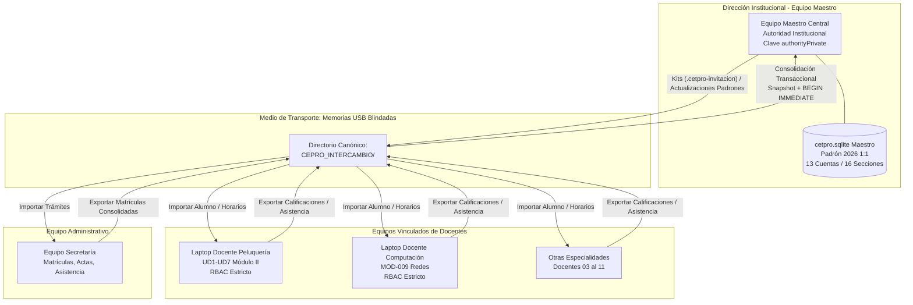
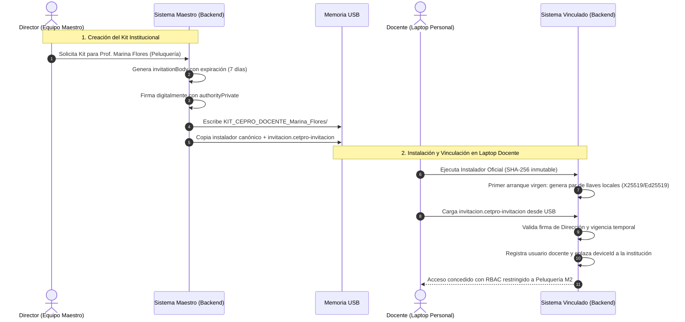
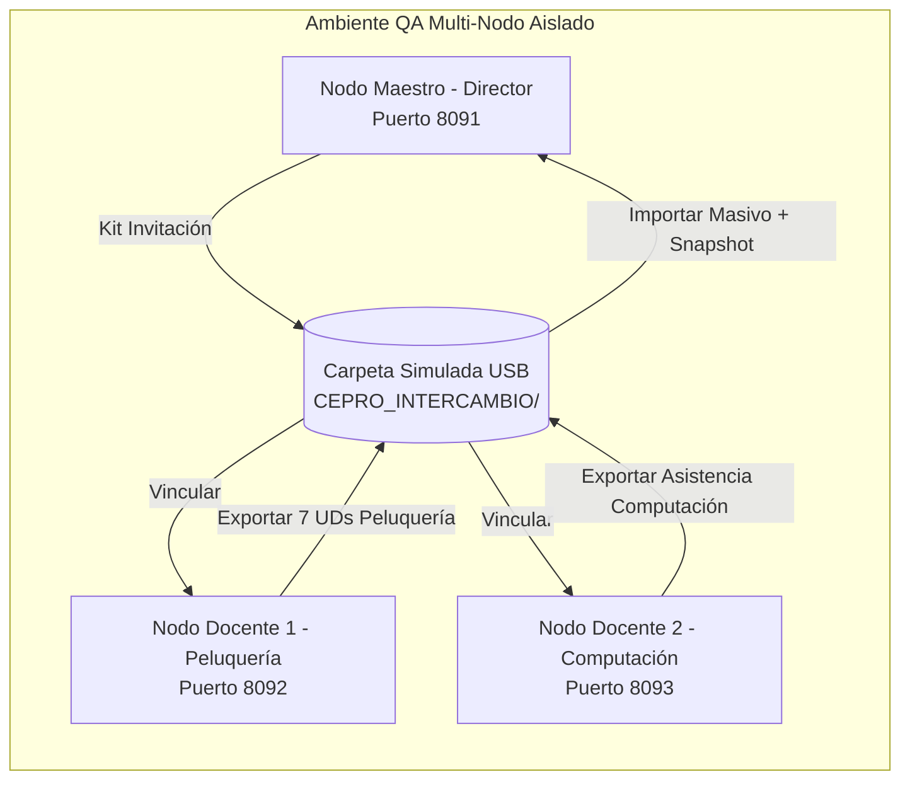

# PLAN MAESTRO: RED INSTITUCIONAL OFFLINE E INTERCAMBIO USB BLINDADO

**Proyecto:** CEPRO_MICAELA 2.0  
**Documento Rector:** `docs/PLAN_RED_INSTITUCIONAL_INTERCAMBIO_OFFLINE.md`  
**Estado:** PLAN FORMAL APROBADO — EN FASE DE IMPLEMENTACIÓN Y SEGUIMIENTO  
**Destinatarios:** Dirección Orquestadora, Equipo de Desarrollo, Auditoría Adversarial  
**Fecha de Emisión:** 03 de noviembre de 2026  

---

## 1. RESUMEN EJECUTIVO Y CONTEXTO OPERATIVO

El CETPRO "Micaela Bastidas Puyucawa" de Juliaca (San Román, Puno) opera en una infraestructura física donde las computadoras de la Dirección, Secretaría y los talleres de formación técnica (Peluquería, Computación, Confección, etc.) se encuentran totalmente desconectadas de internet o carecen de interconexión por red local cableada permanente.

Para responder a esta realidad sin comprometer la seguridad institucional ni forzar dependencias de servidores en la nube, el proyecto implementa la **Red Institucional Offline**. Este modelo transforma un conjunto de computadoras aisladas en una red distribuida coherente, donde:
1. **La verdad institucional reside en el Equipo Maestro** (Dirección Central).
2. **Los equipos de docentes y secretaría son Nodos Vinculados** con acceso estrictamente segregado por roles (RBAC).
3. **El medio físico de transporte es la memoria USB**, utilizando un protocolo blindado de intercambio criptográfico sellado, previsualización sin mutación previa, detección automática de paquetes y respaldos atómicos obligatorios.

El presente plan establece la arquitectura, contratos, garantías de resiliencia y el plan de pruebas multi-nodo para la puesta en marcha de este subsistema.

---

## 2. TOPOLOGÍA INSTITUCIONAL EN ESTRELLA

La Red Institucional Offline adopta una **topología en estrella asimétrica**:



### 2.1 Componentes de la Topología:
- **Equipo Maestro (Hub Institucional):** Operado exclusivamente por el Director. Posee la clave privada institucional (`authorityPrivate`), emite kits de vinculación inviolables, gestiona las 13 cuentas oficiales, aprueba resoluciones curriculares y consolida las actas finales MINEDU.
- **Equipo de Secretaría:** Nodo administrativo de soporte. Registra estudiantes, formaliza matrículas y previsualiza actas de evaluación consolidadas. No puede modificar notas de unidades docentes ni emitir vinculaciones.
- **Equipos Vinculados de Docentes (11 nodos):** Laptops personales o de taller. Solo tienen visibilidad sobre los estudiantes de su aula asignada y únicamente pueden calificar las unidades didácticas que tienen asignadas formalmente en su carga lectiva 2026.

---

## 3. CICLO DE VIDA DEL APROVISIONAMIENTO Y KITS DE VINCULACIÓN

El despliegue de software en las computadoras docentes se rige por el principio de **cero secretos compartidos en instaladores**:



### 3.1 Propiedades de Seguridad de los Kits:
1. **Instalador Oficial Único e Inmutable:** El archivo binario `CEPRO_MICAELA_2.0_Setup_Institucional_x64.exe` (SHA-256: `AE13991D55F5C2A2EF7654DA699D2BB4AA33C898EEAB0CBD673FE738C18D17DF`) es idéntico para todos los equipos. Cero bases de datos ni contraseñas dentro del instalador.
2. **Generación Local de Llaves:** Las claves privadas del nodo vinculado se derivan localmente en el equipo del docente; la clave privada jamás abandona la máquina ni se escribe en la USB.
3. **Expiración Criptográfica:** Toda invitación caduca a los 7 días de su emisión; si no es aceptada en ese plazo, el sistema cliente la rechaza automáticamente.

---

## 4. CONVENCIÓN FÍSICA Y PROTOCOLO USB BLINDADO (`CEPRO_INTERCAMBIO/`)

Para eliminar confusiones y errores humanos al transportar archivos en memorias USB compartidas, se estandariza una estructura física de carpetas canónica:

```
E:\ (Memoria USB)
└── CEPRO_INTERCAMBIO/
    ├── LEAME_RED.txt                     <- Instrucciones claras en texto plano
    ├── para-direccion/                  <- Paquetes exportados por Docentes hacia el Director
    │   ├── 2026-11-03_1030_DE-mflores_HACIA-DIRECCION_lote-01.cetpro
    │   └── 2026-11-03_1115_DE-rquispe_HACIA-DIRECCION_lote-01.cetpro
    ├── para-secretaria/                 <- Paquetes de trámites o matrículas
    ├── para-docentes/                   <- Padrones actualizados emitidos por Dirección
    │   ├── mflores/                     <- Carpeta exclusiva de la docente
    │   │   └── 2026-11-03_PADRON_OFICIAL_PELUQUERIA_M2.cetpro
    │   └── rquispe/                     <- Carpeta exclusiva del docente
    │       └── 2026-11-03_PADRON_OFICIAL_COMPUTACION_MOD09.cetpro
    └── procesados/                      <- Archivos ya consolidados en la base SQLite
        └── 2026-11-03_1030_DE-mflores_PROCESADO_1730689400.cetpro
```

### 4.1 Reglas del Intercambio Blindado:
- **Escritura Atómica en USB:** Todo paquete se escribe primero como archivo temporal `.tmp`. Una vez comprobado que el SHA-256 en disco coincide con el cálculo en memoria, se renombra a `.cetpro`. Esto previene archivos corruptos si la USB es desconectada a mitad de escritura.
- **Previsualización No-Destructiva:** La lectura e inspección de la USB (`/api/network/scan`) parsea el contenido y reporta al usuario cuántas notas, asistencias o matrículas contiene, sin alterar ni una sola tabla en SQLite.
- **Snapshot y Respaldo Obligatorio:** Antes de aplicar cualquier lote en SQLite, el sistema crea un respaldo completo automático en `private-data/backups/antes-sincronizar-lote_TIMESTAMP.cetpro-backup`.
- **Archivado Automático en `procesados/`:** Una vez importado exitosamente un paquete, el archivo físico se traslada a la carpeta `procesados/` para evitar reimportaciones accidentales.

---

## 5. LAS 13 GARANTÍAS ANTI-FALLAS DE RESILIENCIA Y SEGURIDAD

El subsistema de intercambio implementa salvaguardas arquitectónicas exhaustivas para cada vector de riesgo:

| # | Vector de Falla / Riesgo | Salvaguarda Arquitectónica Implementada | Componente Responsable |
| :--- | :--- | :--- | :--- |
| **1** | **Importación duplicada del mismo archivo** | Registro atómico en tabla `receipts` por `packageId` e inserción condicional en `operations`. Las operaciones repetidas se marcan como duplicadas sin generar escrituras redundantes. | `offline-core.cjs` (`importPackage`) |
| **2** | **Archivo de otra institución o forjado** | Firma institucional en certificados + firma digital Ed25519 individual en cada operación. | `offline-core.cjs` (`validateOperation`) |
| **3** | **Docente manipula notas de aula ajena** | Validación estricta en tiempo de ejecución contra la asignación docente (`actor.assignments`). Si intenta calificar otra sección o UD, se rechaza con HTTP 403. | `offline-core.cjs` y `workspace.cjs` |
| **4** | **Corte eléctrico durante la importación** | Snapshot de seguridad previo + transacción inmediata con `BEGIN IMMEDIATE` + modo WAL con durabilidad `synchronous = FULL`. | `offline-core.cjs` y SQLite Engine |
| **5** | **Dos personas editan el mismo estudiante** | Control de Concurrencia Optimista (OCC): validación de revisión base (`current.rev === c.baseRev`). Ante divergencia, se desvía a la tabla `conflicts` para arbitraje directivo. | `offline-core.cjs` y tabla `conflicts` |
| **6** | **Llegada desordenada de archivos en USB** | Ordenamiento causal por revisiones UUID y secuencias de aprovisionamiento; los lotes obsoletos no revierten estados más recientes. | `offline-core.cjs` (`importPackage`) |
| **7** | **Paquete masivo o USB sin espacio** | Segmentación en lotes de hasta 16 MB y verificación preventiva de espacio libre en disco previo a la exportación. | `scripts/institutional-network.cjs` |
| **8** | **Robo o extravío de laptop docente** | Lista negra persistente en `settings.revokedDevices`. Cualquier paquete firmado por el equipo revocado es rechazado de inmediato con HTTP 403. | `scripts/institutional-network.cjs` |
| **9** | **Reemplazo o formateo de laptop** | Protocolo de reemplazo formal (`replaceDevice`), revocando el equipo antiguo y emitiendo un kit nuevo que rehidrata el aula del docente. | `scripts/institutional-network.cjs` |
| **10** | **Discrepancia en versión del software** | Cabeceras de control estricto de versión (`app === 'CETPRO_MICAELA'` y versión de protocolo). | `offline-core.cjs` (`importPackage`) |
| **11** | **Fallo o desconexión abrupta de la USB** | Escritura temporal (`.tmp`), verificación de hash SHA-256 en disco versus memoria y renombrado atómico final. | `scripts/institutional-network.cjs` |
| **12** | **Borrado accidental por sincronización** | Persistencia `append-only` y transiciones de estado explícitas (`active = false`). Cero sentencias `DELETE` sobre registros académicos. | `offline-core.cjs` |
| **13** | **Reloj de sistema alterado o atrasado** | Precedencia de estados gobernada por la cadena de revisiones criptográficas (`rev`), no por el reloj local del sistema operativo. | `offline-core.cjs` |

---

## 6. MAPEO DE CONTRATOS, ARCHIVOS Y ENDPOINTS HTTP

La especificación canónica detallada se encuentra formalizada en [`docs/contracts/RED_INSTITUCIONAL_OFFLINE_CONTRATOS.md`](file:///c:/CETPRO/CETPRO_MODERNIZACION_V2/docs/contracts/RED_INSTITUCIONAL_OFFLINE_CONTRATOS.md).

### 6.1 Módulos de Código:
- **Núcleo de Red:** `scripts/institutional-network.cjs` (Manejo de kits, censo, escaneo USB, exportación e importación masiva).
- **Backend HTTP Local:** `scripts/offline-http.cjs` (Nuevos endpoints `/api/network/*`).
- **Núcleo Transaccional:** `scripts/offline-core.cjs` (Garantías ACID, transacciones y RBAC).

### 6.2 Endpoints Canónicos de la Red:
1. `GET /api/network/status`: Censo de las 13 cuentas oficiales, estado de vinculación y semáforo de sincronización.
2. `POST /api/network/kit`: Creación de kit de vinculación con expiración (exclusivo Director).
3. `POST /api/network/invitation/validate`: Inspección de kit en primer arranque cliente.
4. `POST /api/network/invitation/accept`: Aceptación de kit y registro del nodo vinculado.
5. `POST /api/network/export-batch`: Exportación atómica de paquetes hacia la memoria USB.
6. `POST /api/network/scan`: Escaneo no-destructivo de la USB y previsualización de cambios.
7. `POST /api/network/import-batch`: Consolidación transaccional con respaldo previo en SQLite.
8. `POST /api/network/revoke`: Revocación inmediata de un equipo vinculado extraviado.

---

## 7. MATRIZ DE SIMULACIÓN Y PRUEBAS MULTI-NODO

Para certificar la Red Institucional Offline con independencia adversarial, se establece una batería de pruebas de integración multi-nodo:



### 7.1 Escenarios de Validación Adversarial Requeridos:
1. **Flujo Feliz Completo:** Generación de Kit -> Vinculación de Docente -> Docente califica estudiantes -> Exportación a USB -> Maestro escanea y aplica cambios -> Maestro genera acta oficial MINEDU completa.
2. **Prueba de Inviolabilidad RBAC:** Docente de Computación intenta exportar o modificar notas de Peluquería -> Rechazo tajante con HTTP 403 y 0 alteraciones en la base.
3. **Prueba de Resistencia a Corrupción USB:** Se corrompe 1 byte en un paquete `.cetpro` en la USB -> El escáner maestro detecta firma inválida y aborta la importación sin mutar SQLite.
4. **Prueba de Detección de Duplicados:** Se importa el mismo archivo 3 veces seguidas -> Segunda y tercera importación reportan 0 escrituras y 100% duplicados.
5. **Prueba de Concurrencia (OCC):** Modificación simultánea de un mismo alumno en Maestro y Docente -> Al consolidar, se crea un conflicto 409 explícito en la bandeja de Dirección; ninguna nota es sobrescrita silenciosamente.

---

## 8. LÍMITES IRREVERSIBLES E INVARIANTES DEL PROYECTO

1. **Intangibilidad del Repositorio Histórico Original:**
   - `C:\CETPRO\PAQUETE_ANTIGRAVITY_CETPRO_V2` permanece estrictamente en modo de **solo lectura**. Cero escrituras, modificaciones o ejecuciones sobre él.
2. **Preservación del Binario Homologado:**
   - El instalador oficial institucional (`release/CEPRO_MICAELA_2.0_Setup_Institucional_x64.exe`, SHA-256: `AE13991D55F5C2A2EF7654DA699D2BB4AA33C898EEAB0CBD673FE738C18D17DF`, 166.5 MB) no debe ser alterado ni recompilado para incrustar claves o secretos.
3. **Regresión Cero en Pruebas Automatizadas:**
   - Se debe mantener el 100% de aprobación en las 259 pruebas automatizadas preexistentes:
     * 219/219 en `npm run test:sandbox`.
     * 6/6 en `npm run test:typography`.
     * 5/5 en `npm run test:bundle:clean`.
     * 6/6 en `npm run test:document-filter`.
     * 21/21 formatos MINEDU validados con `Preflight Complete: true` y 0 faltantes.
4. **Preservación Curricular Irrenunciable:**
   - Soporte total a las 7 Unidades Didácticas de Peluquería y Barbería M2 mediante `TMPL-17` y `TMPL-05_EXT`.

---

## 9. CONTROL DE VERSIONES Y ESTADO DEL PLAN

- **Versión del Plan:** 1.0.0 (Aprobado).
- **Responsable de Memoria y Documentación:** `cepro-documentador`.
- **Siguiente Hito:** Verificación de implementación y ejecución de pruebas multi-nodo por `cepro-auditor`.

