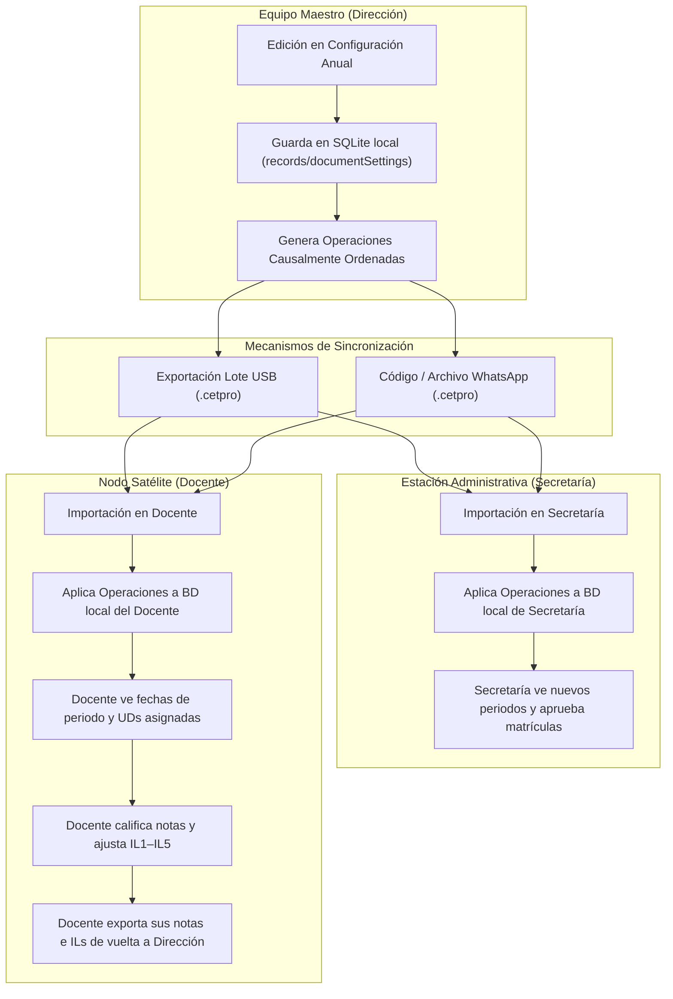

# Trazabilidad de Parámetros de Configuración Anual hacia los 3 Roles

**Fecha:** 2026-11-12  
**Alcance:** Flujo de lectura, escritura y propagación de parámetros de `academic-config.cjs` y `DocumentSettings` hacia Dirección, Secretaría y Docente.

---

## 1. Mapa de Entidades de Configuración Anual

| Entidad SQLite / Clave | Función Institucional | Rol Escritor | Roles Lectores |
|---|---|---|---|
| `settings.institution` | Datos institucionales generales (Nombre, Código Modular, Director, DRE/UGEL) | DIRECTOR | Todos (DIRECTOR, SECRETARIA, DOCENTE) |
| `records('academic_years')` | Años lectivos dados de alta (2026, 2027...) | DIRECTOR | DIRECTOR, SECRETARIA |
| `records('periods')` | Periodos académicos (2026-I, 2026-II) con fechas de inicio y fin | DIRECTOR | Todos |
| `records('programs')` | Programas de estudio oficiales (7 carreras MINEDU) | DIRECTOR | Todos |
| `records('modules')` | Módulos formativos con su malla de Unidades Didácticas | DIRECTOR | Todos |
| `records('groups')` | Secciones y aulas asignadas (turno, sección, aula) | DIRECTOR, SECRETARIA | Todos |
| `records('documentSettings')` | Parámetros pedagógicos específicos: horas, créditos, IL1–IL5, criterios EFSRT | DIRECTOR, DOCENTE (ILs de su UD) | Depende del scope (`institution`, `period`, `group`, `unit`) |

---

## 2. Flujo de Propagación hacia los Roles

---

## 3. Diagnóstico de Desconexión Actual (Puntos Críticos Detectados)

1. **Ausencia de Canal Automático a Secretaría en Exportación USB:**
   - En `scripts/institutional-network.cjs` (`prepareBatchExport`), la exportación masiva del Director itera exclusivamente sobre los usuarios con `role === 'DOCENTE'`.
   - **Fallo:** La carpeta `para-secretaria/` queda vacía. La Secretaría no recibe los paquetes de configuración institucional preparados en USB a menos que se haga una exportación manual específica.
   - **Solución (Fase 3):** Incluir explícitamente a Secretaría en `prepareBatchExport` y crear la subcarpeta `para-secretaria/` con el lote de configuración y aprobaciones.

2. **Falta de Modularización de Paquetes:**
   - Actualmente, tanto `core.packageFor` como `institutional-network.cjs` preparan paquetes monolíticos que mezclan operaciones de configuración con operaciones de matrículas y notas.
   - **Riesgo:** Si un docente sólo desea enviar las notas de la Unidad 2, el paquete exporta todo su historial acumulado, aumentando el tamaño y el riesgo de conflicto.
   - **Solución (Fase 3):** Soportar paquetes por partes (`module: 'config' | 'enrollments' | 'grades' | 'attendance'`).

3. **Autonomía del Docente en Indicadores de Logro (IL1 a IL5):**
   - El docente tiene autoridad pedagógica para redactar los criterios de evaluación e indicadores de logro específicos de su unidad didáctica.
   - Actualmente, si el docente edita IL1–IL5 en `ConfiguracionDocumental.tsx`, el backend valida que tenga la asignación de esa unidad (`requireGroup` / `assignment`).
   - Sin embargo, en el intercambio hacia Dirección, `documentSettings` con scope `unit:<groupId>:<unitCode>` debe transmitirse con prioridad causal para que el acta oficial generada en Dirección refleje los textos redactados por el docente titular sin ser pisados por valores por defecto.
