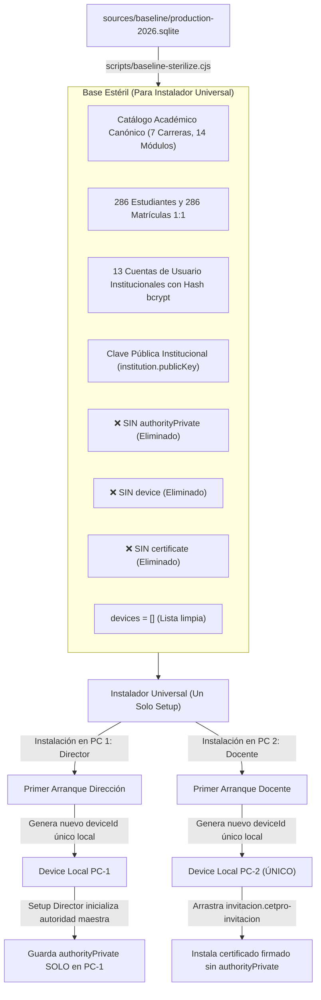

# Auditoría de Seguridad del Instalador: Hallazgo P0 y Arquitectura de Instalador Único

**Fecha:** 2026-11-12  
**Riesgo Identificado:** Severidad P0 (Crítica) — Inclusión de Clave de Autoridad y Dispositivo en la Base Empaquetada.  
**Archivos Afectados:** `sources/baseline/production-2026.sqlite`, `scripts/offline-core.cjs`, `scripts/build-installer-production-2026.cjs`.

---

## 1. Evidencia Empírica del Hallazgo P0

Mediante la inspección de la base de datos `sources/baseline/production-2026.sqlite`:
```javascript
const { DatabaseSync } = require('node:sqlite');
const db = new DatabaseSync('sources/baseline/production-2026.sqlite');
const rows = db.prepare('SELECT key FROM settings').all();
// Resultado: ['authorityPrivate', 'certificate', 'device', 'devices', 'institution', ...]
```

### Vulnerabilidades Inmediatas Derivadas:
1. **Proliferación Involuntaria de Equipos Maestros (Hub Clones):**
   - La presencia de `authorityPrivate` en la base de datos empaquetada por el instalador hace que **cualquier computadora** donde se instale el sistema nazca creyendo que es el "Equipo Maestro" institucional.
   - Cualquier usuario que ejecute la aplicación en su laptop personal podría firmar kits de invitación, revocar dispositivos o actuar con poderes del Director.
2. **Colisión Masiva de Identificadores de Dispositivo (`deviceId`):**
   - La tabla `settings.device` contiene un objeto `{ id: "...", signing: { private, public }, encryption: { private, public } }`.
   - Si 10 docentes instalan el software con esta base, las 10 computadoras tendrán **exactamente el mismo `deviceId`**.
   - En la sincronización en estrella, cuando dos docentes envíen paquetes hacia Dirección, el Hub no podrá distinguir quién originó cada operación, provocando corrupción de causalidad en la tabla `deliveries`.

---

## 2. Solución Arquitectónica: Base de Datos Estéril e Identidad Autogenerada

Para resolver este riesgo de raíz y permitir que **un único instalador universal** sirva a Dirección, Secretaría y Docentes sin conflicto alguno:



---

## 3. Especificación Técnica de `scripts/baseline-sterilize.cjs` (Fase 2)

El script `scripts/baseline-sterilize.cjs` implementará la siguiente lógica determinista:
1. Abrir la base de datos de producción con `DatabaseSync`.
2. Ejecutar transacción atómica de limpieza:
   ```sql
   DELETE FROM settings WHERE key IN ('authorityPrivate', 'certificate', 'device', 'syncTokens', 'provisionSequence');
   UPDATE settings SET value = '[]' WHERE key = 'devices';
   DELETE FROM operations;
   DELETE FROM receipts;
   DELETE FROM deliveries;
   DELETE FROM conflicts;
   ```
3. Insertar auditoría de esterilización:
   ```sql
   INSERT INTO audit (id, value) VALUES ('audit_sterile_01', '{"action":"BASELINE_STERILIZED","at":"2026-11-12T10:00:00Z","version":"2.0"}');
   ```
4. Ejecutar `PRAGMA quick_check;` para verificar integridad estructural (resultado esperado: `'ok'`).
5. Congelar la base saneada con `VACUUM INTO 'sources/baseline/production-2026-sterile.sqlite'`.

Con esta arquitectura, el instalador universal nunca expone claves maestras, no genera colisiones de `deviceId`, y garantiza la interoperabilidad total de la red institucional offline.
