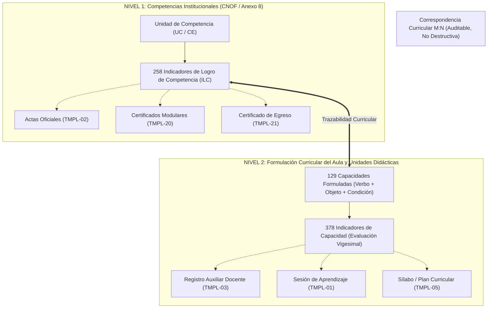

# CONTRATO DE ARQUITECTURA TÉCNICA: CATÁLOGO DOCUMENTAL MODULAR 2026
## Integración del Paquete Documental CEPRO_BD, Separación Estricta de Indicadores y Sincronización Curricular

**Código de Documento:** `CTR-ACAD-2026-CATALOG-01`  
**Estado:** VIGENTE / CONTRATO TÉCNICO NORMATIVO  
**Fecha de Emisión:** 05 de Noviembre de 2026  
**Área Responsable:** Arquitectura Técnica — CEPRO_MICAELA 2.0  
**Destinatarios:** Coordinador General, Ingeniero de Implementación Backend/Frontend, Auditor de Calidad QA  
**Fuente Documental Base:** `sources/cepro-bd-2026/` (`BD CEPRO DOCUMENTOS.pdf`, 150 páginas escaneadas, SHA-256: `ba7960b3db9ae24010b8201cc852fa8f6dd3923b66f5586f25cc846ab36a9620`)

---

## 1. CONTROL DEL DOCUMENTO, ANTECEDENTES Y PRINCIPIOS INQUEBRANTABLES

### 1.1. Contexto Institucional
El proyecto **CEPRO_MICAELA 2.0** cuenta con una base de datos institucional en producción correspondiente al año académico 2026 (`cetpro.sqlite`), que alberga:
- **286 estudiantes únicos** con **286 matrículas activas** en relación canónica exacta **1:1**.
- **13 cuentas de usuario institucionales únicas** (1 Director, 1 Secretaria, 11 Docentes; 0 cuentas `.dev`).
- **16 aulas y secciones activas** en el periodo formativo `2026-I` (y 16 aulas estructuradas para `2026-II`).
- **14 módulos formativos** correspondientes a **7 programas de estudio** aprobados.
- **21 formatos documentales oficiales MINEDU** con preflight 100% aprobado y cero campos faltantes (`verify_all_21_preflights.cjs`).

El paquete documental recibido en `sources/cepro-bd-2026/` aporta por primera vez el **catálogo curricular granular oficial** extraído del expediente documental del CETPRO (150 páginas escaneadas). Dicho expediente contiene la formulación detallada de competencias, capacidades e indicadores de logro para las 7 carreras técnicas.

### 1.2. Principios Inquebrantables de Integración
1. **Inmutabilidad Operativa y Cero Regresión:**  
   La integración del catálogo documental curricular **NO DEBE** alterar, sobrescribir, duplicar ni truncar ninguna de las 286 matrículas (`enrollments`), expedientes de estudiantes (`students`), notas vigesimales (`grades`), asistencias (`attendance`) ni credenciales de usuario (`users`).
2. **Preservación Total de Preflights MINEDU:**  
   La sincronización curricular hacia `documentSettings` debe mantener estrictamente conformes los 21 manifiestos de preflight (`TMPL-01` a `TMPL-21`), preservando las 7 Unidades Didácticas de Peluquería y Barbería M2 mediante `TMPL-17` y `TMPL-05_EXT`.
3. **Segregación Estricta entre Currículo y Operación:**  
   El currículo (competencias, capacidades, indicadores y horas planificadas) es una definición pedagógica independiente de las notas obtenidas, asistencias efectivas o turnos asignados a cada estudiante.
4. **Tratamiento Riguroso de Observaciones de Fuente (No Inferir Silenciosamente):**  
   Cualquier contradicción detectada en el documento original (ej. sumatorias discrepantes, fechas anacrónicas, códigos modulares alternativos o texto descontextualizado) debe almacenarse con estado auditable (`PENDIENTE` o `CUARENTENA`) y resolverse mediante decisión administrativa expresa del Director, jamás mediante heurísticas o suposiciones no autorizadas.

---

## 2. MAPEO CANÓNICO DE IDENTIDAD (`mapa_identidad_importacion`)

### 2.1. Estructura de la Entidad de Mapeo
Para desacoplar de forma permanente los códigos transitorios del paquete documental (`AUTO`, `MOT`, `CM`, `PB`, `CI`, `CE`, `ELE`) de las claves primarias estables utilizadas en la base de datos de producción (`PROG-*`, `MOD-*`, `GRP-*`), se formaliza la tabla de mapeo canónico:

```json
{
  "namespace": "cepro-bd-2026",
  "tipoEntidad": "PROGRAMA | MODULO | AULA_OFERTA | UNIDAD_DIDACTICA",
  "claveArchivo": "AUTO | AUTO-M1 | AUTO-UD01 | ...",
  "ambitoArchivo": "PLAN-2026-CETPRO-MICAELA",
  "entidadDestino": "programs | modules | groups | documentSettings",
  "destinoId": "PROG-001 | MOD-001 | GRP-2026-AUTO-T-A | ...",
  "estado": "CANONICO_VERIFICADO"
}
```

### 2.2. Matriz Canónica Maestra: 7 Programas, 14 Módulos y 16 Secciones

| Programa CEPRO_BD | ID Productivo Programa | Nombre Canónico Oficial | Módulo CEPRO_BD | ID Productivo Módulo | Nombre Canónico del Módulo Formativo | Sección / Grupo Activo 2026-I | Turno | Docente Responsable | Alumnos 1:1 |
|---|---|---|---|---|---|---|---|---|---:|
| **AUTO** | `PROG-001` | MECÁNICA AUTOMOTRIZ | `AUTO-M1` | `MOD-001` | Mantenimiento y Reparación de Sistema de Suspensión, Dirección, Frenos y Transmisión | `GRP-2026-AUTO-T-A` | Tarde | Prof. Édgar Velásquez Vilca | 20 |
| **AUTO** | `PROG-001` | MECÁNICA AUTOMOTRIZ | `AUTO-M2` | `MOD-002` | Diagnóstico y Mantenimiento del Motor de Combustión Interna de los Vehículos Automotrices | *(Preparado para 2026-II)* | Tarde | Prof. Édgar Velásquez Vilca | - |
| **MOT** | `PROG-002` | MECÁNICA DE MOTOS Y VEHÍCULOS AFINES | `MOT-M1` | `MOD-003` | Mantenimiento y Reparación de Sistema de Suspensión, Dirección, Frenos, Transmisión, Sistema Eléctrico y Electrónico de Motos y Vehículos Afines | `GRP-2026-MOTOS-M-A` | Mañana | Prof. Serafín Huanca Castro | 20 |
| **MOT** | `PROG-002` | MECÁNICA DE MOTOS Y VEHÍCULOS AFINES | `MOT-M2` | `MOD-004` | Mantenimiento y Reparación de Motos de Combustión y Conversión del Sistema GNV-GLP | *(Preparado para 2026-II)* | Mañana | Prof. Serafín Huanca Castro | - |
| **CM** | `PROG-003` | CARPINTERÍA METÁLICA | `CM-M1` | `MOD-005` | Construcciones Metálicas de Consumo con Soldadura por Arco Eléctrico en Acero | `GRP-2026-CARP-T-A` | Tarde | Prof. Cesario Julio Ccosi Quenaya | 16 |
| **CM** | `PROG-003` | CARPINTERÍA METÁLICA | `CM-M2` | `MOD-006` | Construcciones Metálicas de Consumo en Aluminio con Soldadura Especial TIG-MIG-MAG-LASER | *(Preparado para 2026-II)* | Tarde | Prof. Cesario Julio Ccosi Quenaya | - |
| **PB** | `PROG-004` | PELUQUERÍA Y BARBERÍA | `PB-M1` | `MOD-007` | Corte de Cabellos, Peinados y Diseño de Barbas | `GRP-2026-PB-M-A1` | Mañana | Prof. Alejandrina Ayna Cabrera | 30 |
| **PB** | `PROG-004` | PELUQUERÍA Y BARBERÍA | `PB-M1` | `MOD-007` | Corte de Cabellos, Peinados y Diseño de Barbas | `GRP-2026-PB-M-A2` | Mañana | Prof. Alejandrina Ayna Cabrera | 5 |
| **PB** | `PROG-004` | PELUQUERÍA Y BARBERÍA | `PB-M1` | `MOD-007` | Corte de Cabellos, Peinados y Diseño de Barbas | `GRP-2026-PB-T-B` | Tarde | Prof. María Azucena Ccolla Villanueva | 17 |
| **PB** | `PROG-004` | PELUQUERÍA Y BARBERÍA | `PB-M1` | `MOD-007` | Corte de Cabellos, Peinados y Diseño de Barbas | `GRP-2026-PB-N-C` | Noche | Prof. Fidelia Jesusa Gutiérrez Loza | 25 |
| **PB** | `PROG-004` | PELUQUERÍA Y BARBERÍA | `PB-M2` | `MOD-008` | Ondulación, Decoloración y Tinturación *(7 UDs protegidas)* | *(Preparado para 2026-II)* | M/T/N | Plan Curricular Homologado 7 UDs | - |
| **CI** | `PROG-005` | COMPUTACIÓN E INFORMÁTICA | `CI-M1` | `MOD-009` | Ofimática | `GRP-2026-COMP-P-A` | Tarde | Prof. René Prudencio Chura Mamani | 26 |
| **CI** | `PROG-005` | COMPUTACIÓN E INFORMÁTICA | `CI-M1` | `MOD-009` | Ofimática | `GRP-2026-COMP-V-B1` | Noche | Prof. Aníbal Bruno Maquera Gil | 20 |
| **CI** | `PROG-005` | COMPUTACIÓN E INFORMÁTICA | `CI-M1` | `MOD-009` | Ofimática | `GRP-2026-COMP-V-B2` | Noche | Prof. Teófilo Larico Canahuire | 22 |
| **CI** | `PROG-005` | COMPUTACIÓN E INFORMÁTICA | `CI-M1` | `MOD-009` | Ofimática | `GRP-2026-COMP-V-B3` | Noche | Prof. Magda Chura Coaquira | 20 |
| **CI** | `PROG-005` | COMPUTACIÓN E INFORMÁTICA | `CI-M1` | `MOD-009` | Ofimática | `GRP-2026-COMP-V-C` | Noche | Prof. René Prudencio Chura Mamani | 20 |
| **CI** | `PROG-005` | COMPUTACIÓN E INFORMÁTICA | `CI-M2` | `MOD-010` | Diseño Gráfico y Plataformas Digitales | *(Preparado para 2026-II)* | T/V | Plan Curricular Modular Homologado | - |
| **CE** | `PROG-006` | CORTE Y ENSAMBLAJE | `CE-M1` | `MOD-011` | Técnicas de Trazado, Tendido y Corte de Prendas de Vestir | `GRP-2026-CORTE-M-A` | Mañana | Prof. Liz Elvira Flores Llanos | 15 |
| **CE** | `PROG-006` | CORTE Y ENSAMBLAJE | `CE-M1` | `MOD-011` | Técnicas de Trazado, Tendido y Corte de Prendas de Vestir | `GRP-2026-CORTE-T-B` | Tarde | Prof. Liz Elvira Flores Llanos | 15 |
| **CE** | `PROG-006` | CORTE Y ENSAMBLAJE | `CE-M1` | `MOD-011` | Técnicas de Trazado, Tendido y Corte de Prendas de Vestir | `GRP-2026-CORTE-N-C` | Noche | Prof. Liz Elvira Flores Llanos | 15 |
| **CE** | `PROG-006` | CORTE Y ENSAMBLAJE | `CE-M2` | `MOD-012` | Técnicas de Confección de Prendas de Vestir | *(Preparado para 2026-II)* | M/T/N | Prof. Liz Elvira Flores Llanos | - |
| **ELE** | `PROG-007` | MANTENIMIENTO DE SISTEMAS ELÉCTRICOS | `ELE-M1` | `MOD-013` | Instalación de Sistemas Eléctricos en Edificaciones | `GRP-2026-ELEC-T-A` | Tarde | Lic. Eloy Valerio Paredes Feliciano | 20 |
| **ELE** | `PROG-007` | MANTENIMIENTO DE SISTEMAS ELÉCTRICOS | `ELE-M2` | `MOD-014` | Mantenimiento de Equipos Electrónicos y Sistemas de Seguridad en Domótica | *(Preparado para 2026-II)* | Tarde | Lic. Eloy Valerio Paredes Feliciano | - |

**Totales del Padrón Activo 2026-I:**  
- **16 secciones activas**  
- **286 estudiantes matriculados únicos (relación exacta 1:1)**  
- **0 colisiones de matrícula**

---

## 3. SEPARACIÓN ESTRICTA DE LOS DOS NIVELES DE INDICADORES

El sistema pedagógico de educación técnico-productiva normado por el MINEDU (RVM 277-2019-MINEDU y Lineamientos Académicos Generales) establece una jerarquía dual que **BAJO NINGUNA CIRCUNSTANCIA DEBE FUSIONARSE O APLANARSE EN UNA SOLA LISTA**.



### 3.1. Nivel 1: Indicadores de Logro de Competencia (`UC/CE`, Anexo 8) — 258 Registros
- **Definición:** Criterios normativos estándar de competencia laboral definidos en el perfil de egreso (Anexo 8 del expediente documental).
- **Entidad Padre Exclusiva:** Unidad de Competencia Específica (`UC`) o Competencia de Empleabilidad (`CE`). No tienen ni requieren capacidad formulada como padre.
- **Función Oficial:** Respaldan la certificación modular y titulación ante el MINEDU.
- **Distribución de los 258 registros en `CEPRO_BD`:**
  1. `PROG-001` (Mecánica Automotriz): **40** indicadores de competencia (`AUTO-ILC01`..`AUTO-ILC40`).
  2. `PROG-002` (Mecánica de Motos): **50** indicadores de competencia (`MOT-ILC01`..`MOT-ILC50`).
  3. `PROG-003` (Carpintería Metálica): **44** indicadores de competencia (`CM-ILC01`..`CM-ILC44`).
  4. `PROG-004` (Peluquería y Barbería): **34** indicadores de competencia (`PB-ILC01`..`PB-ILC34`).
  5. `PROG-005` (Computación e Informática): **19** indicadores de competencia (`CI-ILC01`..`CI-ILC19`).
  6. `PROG-006` (Corte y Ensamblaje): **26** indicadores de competencia (`CE-ILC01`..`CE-ILC26`).
  7. `PROG-007` (Sistemas Eléctricos): **45** indicadores de competencia (`ELE-ILC01`..`ELE-ILC45`, Anexo 8 pp. 144–147).
  - **Total Nivel 1:** **258 Indicadores de Logro de Competencia**.

### 3.2. Nivel 2: Capacidades de Formulación y sus Indicadores de Capacidad
- **Nivel 2A: 129 Capacidades de Formulación:**
  - Redactadas siguiendo la directriz curricular oficial: `[Verbo de acción en presente indicativo] + [Objeto conceptual / contenido] + [Condición de calidad y contexto]`.
  - Entidad padre: Módulo formativo (`modulo_id`) o plan de estudio.
  - Distribución: Automotriz (10), Motos (35), Carpintería (14), Peluquería (15), Computación (11), Corte (32), Eléctricos (12) = **129 Capacidades**.
- **Nivel 2B: 378 Indicadores de Capacidad (Evaluación Operativa):**
  - Entidad padre obligatoria: La Capacidad formulada correspondiente (`capacidad_id`).
  - Función Oficial: Son los indicadores calificados vigesimalmente (00 a 20) por los docentes en las evaluaciones continuas del periodo lectivo (utilizados en `RegistroEvaluaciones.tsx` y `TMPL-03`).
  - Distribución: Automotriz (34), Motos (147), Carpintería (42), Peluquería (66), Computación (35), Corte (32), Eléctricos (22) = **378 Indicadores de Capacidad**.

### 3.3. Reglas de Desacople e Integridad Inviolables
1. **Diferenciación de Claves:** Ningún indicador de capacidad puede tener como padre una `UC` o `CE`. Ningún indicador de competencia puede tener como padre una `capacidad`.
2. **Independencia Evaluativa:** La calificación vigesimal de los indicadores de capacidad del Nivel 2 en las UDs genera el promedio de la capacidad, el cual a su vez valida el logro de la competencia (Nivel 1). No se debe clonar una nota de indicador de capacidad sobre un indicador de competencia de forma directa sin la regla de equivalencia aprobada.
3. **Correspondencia M:N Trazable:** Si se establece relación entre un indicador de competencia y una capacidad, se registra en una estructura de relación (`correspondencias`) con su página de procedencia del PDF, sin fusionar registros.

---

## 4. MODELO DE ALMACENAMIENTO Y EDICIÓN FUTURA EN `documentSettings`

Para operar de forma limpia dentro del motor SQLite WAL existente sin requerir migraciones DDL destructivas ni alterar tablas del núcleo, el catálogo modular 2026 se almacena y administra mediante particiones estructuradas en la entidad `documentSettings`.

### 4.1. Estructura de Claves Particionadas en `documentSettings`

```
documentSettings:
  ├── catalogIdentityMap:2026               (Mapa de resolución de identidades)
  ├── catalogProgram:PROG-001               (Catálogo curricular completo de Automotriz)
  ├── catalogProgram:PROG-002               (Catálogo curricular completo de Motos)
  ├── catalogProgram:PROG-003               (Catálogo curricular completo de Carpintería)
  ├── catalogProgram:PROG-004               (Catálogo curricular completo de Peluquería)
  ├── catalogProgram:PROG-005               (Catálogo curricular completo de Computación)
  ├── catalogProgram:PROG-006               (Catálogo curricular completo de Corte y Ensamblaje)
  ├── catalogProgram:PROG-007               (Catálogo curricular completo de Sistemas Eléctricos)
  ├── catalogIssue:AUD-001 ... AUD-016      (Incidencias y hallazgos documentales en revisión)
  ├── catalogParameter:PARAM_KEY            (Parámetros académicos oficiales)
  └── catalogQuarantine:QUARANTINE_ID       (Elementos curriculares segregados en cuarentena)
```

### 4.2. Esquema JSON Detallado por Tipo de Registro

#### 4.2.1. `catalogProgram:{programId}`
```json
{
  "id": "catalogProgram:PROG-001",
  "scope": { "kind": "catalogProgram", "target": "PROG-001", "year": "2026" },
  "fields": {
    "programId": "PROG-001",
    "codeCeProBd": "AUTO",
    "nombreOficial": "MECÁNICA AUTOMOTRIZ",
    "codigoCnof": "G21",
    "codigoModular": "1027648",
    "cicloFormativo": "Auxiliar Técnico",
    "modalidad": "Presencial",
    "horasDeclaradas": 1056,
    "creditosDeclarados": 40,
    "perfilEgreso": "Auxiliar técnico capaz de realizar mantenimiento y reparación de sistemas vehiculares...",
    "ambitosDesempeno": [
      "Talleres automotrices de mantenimiento",
      "Empresas de transporte de carga y pasajeros",
      "Servicios mecánicos municipales y regionales"
    ],
    "competencias": [
      {
        "id": "AUTO-UC1",
        "codigo": "UC1",
        "tipo": "ESPECIFICA",
        "descripcion": "Realizar el mantenimiento y reparación de los sistemas de frenos, dirección, suspensión y transmisión...",
        "moduloId": "MOD-001",
        "paginaPdf": 4
      }
    ],
    "indicadoresCompetencia": [
      {
        "id": "AUTO-ILC01",
        "competenciaId": "AUTO-UC1",
        "codigo": "ILC1",
        "descripcion": "Diagnostica el estado operativo de los componentes de frenos y suspensión según especificaciones...",
        "orden": 1,
        "paginaPdf": 6
      }
    ],
    "capacidades": [
      {
        "id": "AUTO-M1-C01",
        "moduloId": "MOD-001",
        "codigo": "C1",
        "verbo": "Organizar",
        "objeto": "el aula taller automotriz y puestos de trabajo",
        "condicion": "cumpliendo normas de seguridad, salud ocupacional y medio ambiente",
        "descripcionCompleta": "Organizar el aula taller automotriz y puestos de trabajo cumpliendo normas de seguridad...",
        "paginaPdf": 13
      }
    ],
    "indicadoresCapacidad": [
      {
        "id": "AUTO-M1-C01-I1",
        "capacidadId": "AUTO-M1-C01",
        "codigo": "I1",
        "descripcion": "Acondiciona las áreas de trabajo, herramientas y equipos de protección personal según normativa...",
        "orden": 1,
        "unidadDidacticaId": "AUTO-UD01",
        "paginaPdf": 13
      }
    ],
    "correspondencias": [
      {
        "competenciaId": "AUTO-UC1",
        "capacidadId": "AUTO-M1-C01",
        "tipoRelacion": "DESARROLLA_DIRECTAMENTE",
        "evidenciaPagina": 13
      }
    ],
    "estadoRevision": "APROBADO_INSTITUCIONAL",
    "ultimaActualizacion": "2026-11-05T00:00:00.000Z",
    "actualizadoPor": "eloy.paredes"
  }
}
```

#### 4.2.2. `catalogIssue:{issueId}`
```json
{
  "id": "catalogIssue:AUD-005",
  "scope": { "kind": "catalogIssue", "target": "AUD-005", "year": "2026" },
  "fields": {
    "issueId": "AUD-005",
    "programId": "PROG-004",
    "paginaPdf": 68,
    "tipo": "DISCREPANCIA_HORAS",
    "titulo": "Peinados módulo I muestra 92h; suma da 524h frente a 528h declaradas",
    "valorObservado": "Peinados: 92h (Suma filas M1: 524h; total impreso: 528h)",
    "valorPropuesto": "Peinados: 96h (Consistente con 3 créditos: 32 HT + 64 HP = 96h, total M1 = 528h)",
    "estado": "PENDIENTE_RESOLUCION_DIRECTORAL",
    "resolucion": null,
    "justificacion": null,
    "resueltoPor": null,
    "fechaResolucion": null
  }
}
```

#### 4.2.3. `catalogQuarantine:{id}`
```json
{
  "id": "catalogQuarantine:QUAR-MOT-001",
  "scope": { "kind": "catalogQuarantine", "target": "QUAR-MOT-001", "year": "2026" },
  "fields": {
    "id": "QUAR-MOT-001",
    "programId": "PROG-002",
    "paginaPdf": 38,
    "motivo": "CONTENIDO_TEXTIL_INTRUSO_EN_MECANICA_MOTOS",
    "descripcion": "Texto referente a antropometría del cuerpo humano, medidas anatómicas y fibras textiles impreso en elementos de Motos",
    "contenidoBloqueado": "Antropometría del cuerpo humano, toma de medidas, fibras textiles y ficha técnica de confección",
    "estado": "CUARENTENA_PERMANENTE",
    "accion": "AISLAR_DEL_PLAN_ACTIVO"
  }
}
```

### 4.3. Algoritmo de Sincronización Bidireccional Segura
La sincronización curricular proyecta los datos del catálogo documental hacia las estructuras de ejecución:
1. **Hacia `curriculum:{moduleId}`:**
   - Actualiza `programName`, `programCode`, `programHours`, `programCredits`, `nivelFormativo`, `hours`, `credits`, `efsrtHours`.
   - Inyecta la colección de competencias y capacidades aprobadas.
2. **Hacia `moduleDefaults:{moduleId}`:**
   - Actualiza el campo `dataJson` con la nómina normalizada de Unidades Didácticas (UDs), horas teóricas/prácticas y créditos.
   - **Preservación Inviolable de Peluquería y Barbería M2:** Conserva íntegramente las 7 UDs de `MOD-008` requeridas para los preflights de `TMPL-17` y `TMPL-05_EXT`.
3. **Hacia `unitCurriculum:{groupId}:{unitId}`:**
   - Sincroniza las horas y créditos de cada UD en cada grupo activo respetando las calendarizaciones de inicio y fin ya pactadas.
4. **Verificación de Invariantes Previas al Guardado:**
   - Verifica que el recuento de matrículas sea exactamente 286.
   - Ejecuta validación sintética de preflights. Si algún campo obligatorio de los 21 manifiestos queda incompleto, se aborta la sincronización (`ROLLBACK`).

---

## 5. CONTRATO FORMAL DE ENDPOINTS HTTP (API REST)

Todos los endpoints exigen autenticación obligatoria (`Authorization: Bearer <token>` o sesión de usuario activa) y escucha exclusiva en loopback local (`127.0.0.1`), protegidos por `X-CETPRO-Instance-Secret` en el proceso Electron.

### 5.1. `GET /api/academic/documentary-catalog?year=2026`
- **Descripción:** Obtiene el catálogo documental modular completo, incluyendo programas, competencias, ambos niveles de indicadores, incidencias observadas y parámetros institucionales.
- **Roles Autorizados:** `DIRECTOR`, `SECRETARIA`, `DOCENTE` (Docente accede a vista contextual de su respectivo programa asignado; Director y Secretaría acceden a vista global).
- **Parámetros de Consulta:**
  - `year` (opcional, string): Año curricular de consulta (por defecto `2026`).
  - `programId` (opcional, string): Filtrado por programa específico (`PROG-001`..`PROG-007`).
- **Respuesta Exitosa (HTTP 200 OK):**
```json
{
  "success": true,
  "year": "2026",
  "summary": {
    "programsCount": 7,
    "modulesCount": 14,
    "capacidadesCount": 129,
    "indicadoresCapacidadCount": 378,
    "indicadoresCompetenciaCount": 258,
    "issuesCount": 16,
    "issuesPendingCount": 14,
    "quarantineCount": 2,
    "activeStudentsCount": 286,
    "activeClassroomsCount": 16
  },
  "programs": [ /* Array de 7 objetos catalogProgram con competencias e indicadores */ ],
  "issues": [ /* Array de incidencias catalogIssue */ ],
  "parameters": [ /* Array de parámetros institucionales catalogParameter */ ],
  "quarantine": [ /* Array de registros en cuarentena catalogQuarantine */ ],
  "identityMap": {
    "AUTO": "PROG-001",
    "MOT": "PROG-002",
    "CM": "PROG-003",
    "PB": "PROG-004",
    "CI": "PROG-005",
    "CE": "PROG-006",
    "ELE": "PROG-007"
  }
}
```

### 5.2. `POST /api/academic/documentary-catalog/save-program`
- **Descripción:** Guarda o actualiza la formulación curricular de un programa de estudios (capacidades, indicadores de capacidad y competencias).
- **Roles Autorizados:** `DIRECTOR`, `SECRETARIA`.
- **Cuerpo de la Petición (Request Body):**
```json
{
  "programId": "PROG-001",
  "expectedRev": "08d88bdc-7937-453c-a45b-4ef5849377ee",
  "programData": {
    "horasDeclaradas": 1056,
    "creditosDeclarados": 40,
    "perfilEgreso": "Texto oficial actualizado...",
    "capacidades": [ /* Array de capacidades actualizadas */ ],
    "indicadoresCapacidad": [ /* Array de indicadores de capacidad actualizados */ ],
    "indicadoresCompetencia": [ /* Array de indicadores de competencia */ ],
    "correspondencias": [ /* Relaciones M:N */ ]
  },
  "changeReason": "Alineación con Resolución Directoral N° 042-2026-CETPRO-MB"
}
```
- **Respuesta Exitosa (HTTP 200 OK):**
```json
{
  "success": true,
  "programId": "PROG-001",
  "rev": "fa99214a-85d1-447b-8911-399fa5183ef9",
  "updatedAt": "2026-11-05T01:15:30.120Z"
}
```
- **Errores:** HTTP 400 (Sintaxis inválida), HTTP 403 (Permiso denegado), HTTP 409 (Conflicto de concurrencia OCC `expectedRev` no coincide).

### 5.3. `POST /api/academic/documentary-catalog/resolve-issue`
- **Descripción:** Registra formalmente la resolución de una incidencia o contradicción observada en la fuente (AUD-001 a AUD-016).
- **Roles Autorizados:** `DIRECTOR` exclusivamente.
- **Cuerpo de la Petición (Request Body):**
```json
{
  "issueId": "AUD-005",
  "resolution": "ACEPTADO",
  "resolvedValue": "96 horas en UD Peinados (Módulo I = 528h)",
  "justification": "Aprobado según acta de consolidación curricular docente. Se asignan 3 créditos equivalentes a 32 horas de teoría y 64 horas de práctica, alcanzando 528h en el Módulo I y 1056h totales.",
  "documentReference": "Acta Curricular Ordinaria N° 03-2026 / RD-014-CETPRO"
}
```
- **Respuesta Exitosa (HTTP 200 OK):**
```json
{
  "success": true,
  "issueId": "AUD-005",
  "status": "RESUELTO",
  "resolvedAt": "2026-11-05T01:20:00.000Z",
  "resolvedBy": "eloy.paredes"
}
```
- **Errores:** HTTP 400 (Datos faltantes), HTTP 403 (Requiere rol de Director), HTTP 404 (Incidencia no encontrada).

### 5.4. `POST /api/academic/documentary-catalog/save-parameter`
- **Descripción:** Configura parámetros institucionales y pedagógicos para la operación del software (escalas, umbrales, equivalencias).
- **Roles Autorizados:** `DIRECTOR` exclusivamente.
- **Cuerpo de la Petición (Request Body):**
```json
{
  "paramKey": "passing_score",
  "paramValue": 13,
  "description": "Nota mínima aprobatoria en escala vigesimal (00 a 20) según Lineamientos Académicos Generales MINEDU",
  "category": "EVALUACION"
}
```
- **Respuesta Exitosa (HTTP 200 OK):**
```json
{
  "success": true,
  "paramKey": "passing_score",
  "paramValue": 13,
  "updatedAt": "2026-11-05T01:25:00.000Z"
}
```

### 5.5. `POST /api/academic/documentary-catalog/sync-to-curriculum`
- **Descripción:** Ejecuta la sincronización transaccional bidireccional desde el catálogo documental hacia `curriculum`, `moduleDefaults` y `unitCurriculum`.
- **Roles Autorizados:** `DIRECTOR` exclusivamente.
- **Cuerpo de la Petición (Request Body):**
```json
{
  "programId": null,
  "dryRun": false,
  "forcePreflightValidation": true
}
```
- **Respuesta Exitosa (HTTP 200 OK):**
```json
{
  "success": true,
  "dryRun": false,
  "syncedPrograms": ["PROG-001", "PROG-002", "PROG-003", "PROG-004", "PROG-005", "PROG-006", "PROG-007"],
  "syncedModules": ["MOD-001", "MOD-002", "MOD-003", "MOD-004", "MOD-005", "MOD-006", "MOD-007", "MOD-008", "MOD-009", "MOD-010", "MOD-011", "MOD-012", "MOD-013", "MOD-014"],
  "syncedUnitsCount": 96,
  "preflightStatus": {
    "allReady": true,
    "verifiedTemplatesCount": 21,
    "missingFieldsCount": 0
  },
  "enrollmentsPreserved": 286,
  "timestamp": "2026-11-05T01:30:00.000Z"
}
```

---

## 6. MATRIZ DE INCIDENCIAS DOCUMENTALES (AUD-001 A AUD-016)

| ID Incidencia | Página PDF | Hecho Observado en Fuente | Riesgo para la Base de Datos | Tratamiento y Regla de Negocio Exigida | Estado Inicial |
|---|---:|---|---|---|---|
| **AUD-001** | 22 | Mecánica de Motos tiene código modular impreso `5705507` frente al código institucional `1027648`. | Crear dos instituciones o asignar programa a entidad ajena. | Conservar `codigo_fuente='5705507'` como evidencia. Vincular a la institución canónica `1027648`. Requiere resolución del Director. | `PENDIENTE` |
| **AUD-002** | 22 | Motos declara 1088 horas y 40 créditos en portada de programa. | Imponer erróneamente 1056 horas o desbalancear módulos. | Preservar 1088 horas y 40 créditos en el catálogo de Motos; no forzar a 1056h. | `PENDIENTE` |
| **AUD-003** | 38 | Elementos de Motos incluyen antropometría humana, medidas, fibras textiles y fichas de confección. | Contaminar el currículo mecánico con contenidos textiles. | **CUARENTENA TOTAL:** Enviar a `catalogQuarantine:QUAR-MOT-001`. Prohibir activación en `MOD-003`. No mover a Corte sin autorización. | `CUARENTENA` |
| **AUD-004** | 47 | Anexo 8 de Carpintería Metálica cita `CETPRO PUNO` y programa `Técnico-Productiva`. | Duplicar institución o desasociar la carrera. | Mantener texto literal como evidencia. Asignar formalmente al programa canónico `PROG-003` (`CARPINTERÍA METÁLICA`). | `PENDIENTE` |
| **AUD-005** | 68 | Peinados (Módulo I de Peluquería) indica 92h. Suma da 524h frente a 528h declaradas. | Descuadre en Actas consolidadas y Certificados Modulares. | Bloquear sincronización de carga horaria. Registrar propuesta de 96h (3 créditos). Sincronizar tras resolución de Dirección. | `PENDIENTE` |
| **AUD-006** | 68 | UDs de Peluquería M2 tienen fechas con año `2025` (Diagnóstico capilar II 10/08/2025, Emprendimiento 13/10/2025). | Descalce de calendario anual mayor a un año. | Conservar fechas literales en evidencia. En la oferta activa de `2026-II` aplicar fechas del calendario 2026 homologado. | `PENDIENTE` |
| **AUD-007** | 122 | Acabados de confección en Corte y Ensamblaje inicia `18/10/26` y culmina `09/10/26`. | Intervalo cronológico invertido inválido. | Bloquear fecha de inicio/fin en catálogo activo. Conservar en evidencia y exigir rectificación de calendario a Dirección. | `PENDIENTE` |
| **AUD-008** | 105 | Código del programa de Computación e Informática figura como `0.00`. | Usar un marcador como código oficial CNOF. | Registrar `codigo_fuente='0.00'`. Utilizar como código canónico en el sistema el código oficial `J2662-1-001`. | `PENDIENTE` |
| **AUD-009** | 143 | Título Mantenimiento de Sistemas Eléctricos; descripción cita sistemas electrónicos. | Ambigüedad en denominación de títulos modulares. | Mantener título formal `MANTENIMIENTO DE SISTEMAS ELÉCTRICOS`. Mantener descripciones electrónicas en evidencia de `MOD-014`. | `PENDIENTE` |
| **AUD-010** | 148–150 | Códigos de indicador `C1 I1`, `C1 I2` se reutilizan en múltiples capacidades distintas. | Colisión de claves primarias compuestas. | Desambiguar mediante claves jerárquicas estables: `{moduloId}-{capacidadCodigo}-{indicadorCodigo}`. | `RESUELTO_ARQUITECTURA` |
| **AUD-011** | 150 | Última fila de tabla eléctrica queda vacía; bloque curricular termina abruptamente en p. 150. | Suponer programa completo o inventar UDs ficticias. | Registrar estado `CURRICULO_PARCIAL`. No inventar UDs no documentadas para Sistemas Eléctricos. | `PENDIENTE` |
| **AUD-012** | 45–52 | Orden y códigos de Ética y Emprendimiento en Carpintería varían entre páginas. | Incoherencia en códigos de competencia de empleabilidad. | Conservar relaciones propuestas sin sustituir texto; resolver mediante correspondencia M:N. | `PENDIENTE` |
| **AUD-013** | 103–109 | Denominación Ética y códigos CE en Computación no coinciden con su contenido. | Definición distorsionada de competencias de empleabilidad. | Conservar textos literales de cada página en evidencia; no sobreescribir Ética con Emprendimiento. | `PENDIENTE` |
| **AUD-014** | 128–130 | Códigos `UC4-C1..C3` repetidos en Corte y Ensamblaje; módulo III vacío sin UDs. | Activación errónea de un tercer módulo inexistente. | Confinar Módulo III a `catalogQuarantine`. Asignar claves compuestas con ámbito modular en M1 y M2. | `CUARENTENA` |
| **AUD-015** | Global | Capacidades reaparecen en formulación, elementos e itinerario con variaciones menores. | Proliferación de capacidades duplicadas artificialmente. | Crear una única entidad canónica conceptual vinculada a múltiples evidencias documentales. | `RESUELTO_ARQUITECTURA` |
| **AUD-016** | Global | Indicadores de logro de UC/CE (Anexo 8) e indicadores de capacidad son niveles distintos. | Fusión y aplanamiento de niveles pedagógicos incompatibles. | **SEPARACIÓN ESTRICTA:** Nivel 1 (258 indicadores UC/CE) vs Nivel 2 (378 indicadores de capacidad). | `RESUELTO_ARQUITECTURA` |

---

## 7. GARANTÍAS DE CALIDAD Y CRITERIOS DE ACEPTACIÓN

Para que la implementación modular de este contrato se considere aprobada:

1. **Aislamiento en Staging y Resguardo Absoluto:**
   - La base de datos original `dev-sandbox/data/cetpro.sqlite` y la línea base de producción `sources/baseline/production-2026.sqlite` deben permanecer intactas con sus 286 matrículas exactas.
2. **Pruebas Automatizadas de Regresión:**
   - `npm run test:sandbox`: 219/219 pruebas aprobadas en las 22 suites existentes.
   - `scripts/verify_all_21_preflights.cjs`: 21/21 manifiestos MINEDU aprobados (`Preflight Complete: true`, 0 campos faltantes).
   - `npm run test:bundle:clean`: 5/5 pruebas aprobadas (0 leyendas de demo, 0 credenciales dev).
   - `npm run test:document-filter`: 6/6 casos aprobados.
3. **Persistencia e Idempotencia:**
   - La re-ejecución del proceso de carga del catálogo documental modular no debe duplicar registros, no debe alterar UUIDs ya asignados y debe ser 100% transaccional e idempotente.
4. **Respeto a los Roles RBAC:**
   - Los endpoints de resolución de incidencias, salvaguarda de parámetros y sincronización al currículo deben estar estrictamente restringidos al rol `DIRECTOR`.
5. **No Afectación de Código Fuera del Alcance:**
   - No se deben alterar archivos en `scripts/` o `src/` sin una tarea específica de implementación que siga este contrato.

---
*Fin del Contrato de Arquitectura Técnica CTR-ACAD-2026-CATALOG-01.*