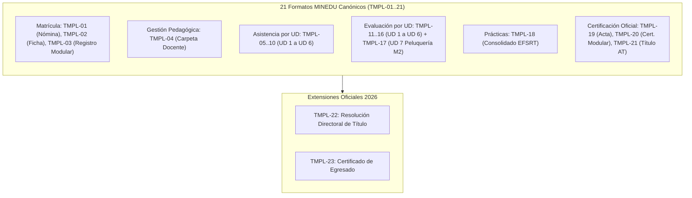
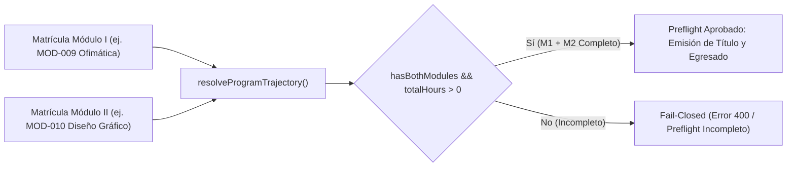
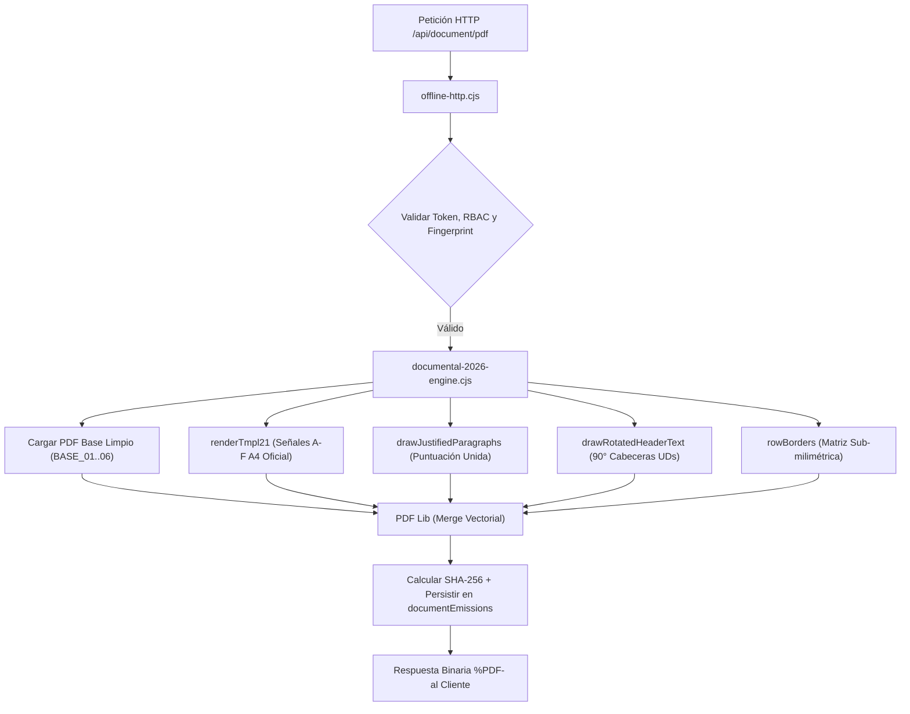

# SISTEMA DOCUMENTAL OFICIAL 2026 — CEPRO_MICAELA 2.0
## Informe Técnico Consolidado de Cierre y Transferencia de los 10 Entregables

**Código de Documento:** `DOC-2026-ENTREGABLES-CONSOLIDADO`  
**Versión:** 2.0.0-PRODUCCIÓN-2026  
**Fecha de Cierre:** 15 de Noviembre de 2026  
**Área Responsable:** Arquitectura Técnica & Documental — CEPRO_MICAELA 2.0  
**Destinatarios:** Dirección Institucional, Coordinación Académica, Secretaría General, Auditoría de Calidad QA  
**Estado:** AUDITADO Y APROBADO (Lotes Doc-1 a Doc-5)

---

## RESUMEN EJECUTIVO

El presente documento formaliza la entrega y transferencia institucional del **Sistema Documental Oficial 2026** para la plataforma **CEPRO_MICAELA 2.0**. Dicho sistema culmina exitosamente el ciclo de modernización documental, consolidando:

1. **La integración de las 6 plantillas oficiales 2026** (`BASE_01` a `BASE_06`), implementadas sobre activos gráficos institucionales limpios a 300 DPI y con inyección milimétrica de datos.
2. **La preservación irrestricta de los 21 formatos normativos canónicos del MINEDU** (`TMPL-01` a `TMPL-21`), garantizando cero regresiones, preflight 100% aprobado y compatibilidad con las 7 Unidades Didácticas de Peluquería y Barbería M2 (`TMPL-17`).
3. **El motor documental PDF 2026** con plantilla oficial A4 horizontal exacta de Título (`Plantilla_02_Titulo_Auxiliar_Tecnico_corregida.pdf`, señal A vertical rotada 90° en portada y repetida en línea institucional + pie de reverso, señal B UGEL independiente, señal C resolución de referencia, D–F editables y sin código de barras en reverso), alineación justificada de párrafos con puntuación integrada, cabeceras rotadas a 90° para actas y matriz de calibración milimétrica para nóminas.
4. **La persistencia histórica y trazabilidad criptográfica** en SQLite (`documentEmissions`), garantizando correlativos estrictamente unívocos, auditoría por usuario y exclusión total de paquetes de sincronización de red.
5. **El control de acceso por roles (RBAC) y fail-closed**, asegurando que solo el Director emita Títulos y Resoluciones Directorales, que Secretaría opere certificados y actas, y que Docente acceda exclusivamente a sus registros pedagógicos.
6. **La verificación exhaustiva e independiente**: 6/6 tests de modernización superados, 21/21 preflights aprobados y 29 artefactos visuales comparativos certificados.

---

## 1. ENTREGABLE 1: INVENTARIO DOCUMENTAL OFICIAL Y HOMOLOGACIÓN DE FORMATOS

### 1.1. Correspondencia Exacta de las 6 Plantillas Oficiales 2026
El proceso de modernización documental 2026 sincronizó los diseños vectoriales y maquetas oficiales (`BASE_01` a `BASE_06`) con los contratos del sistema, estableciendo una biyección técnica estricta:

| Código Base 2026 | Archivo PDF Base | Código Plantilla | Denominación Oficial en Sistema | Formato y Páginas | Destinatario Principal |
| :--- | :--- | :--- | :--- | :--- | :--- |
| **BASE_01** | `BASE_01_RD_TITULO_2026.pdf` | `TMPL-22` | **Resolución Directoral de Título** | A4 Vertical (1 pág.) | Estudiante Egresado / DRE / UGEL |
| **BASE_02** | `BASE_02_TITULO_AUXILIAR_2026.pdf` | `TMPL-21` | **Título Oficial de Auxiliar Técnico** | A4 Horizontal (`841.89×595.28 pt`, 2 págs.) | Egresado Titulado (A vertical portada + A/B reverso) |
| **BASE_03B** | `BASE_03B_CERTIFICADO_MODULAR_2026.pdf` | `TMPL-20` | **Certificado Modular Oficial** | A4 Vertical (2 págs: Anverso/Reverso) | Estudiante que aprobó Módulo I o Módulo II |
| **BASE_04** | `BASE_04_CERTIFICADO_EGRESADO_2026.pdf` | `TMPL-23` | **Certificado de Egresado** | A4 Horizontal (1 pág.) | Estudiante que completó M1 + M2 (Trayectoria) |
| **BASE_05** | `BASE_05_ACTA_EVALUACION_2026.pdf` | `TMPL-19` | **Acta Oficial de Evaluación Modular** | A4 Horizontal (2 págs: Anverso/Reverso) | Registro Oficial UGEL / Archivo Institucional |
| **BASE_06** | `BASE_06_NOMINA_MATRICULA_2026.pdf` | `TMPL-01` | **Nómina de Matrícula Oficial** | A4 Vertical (Multi-pág: 30 alumnos/pág) | Registro de Matrícula UGEL / Apertura Modular |

### 1.2. Preservación Total del Catálogo Canónico MINEDU (21 Formatos)
El sistema preserva sin alteración los 21 formatos canónicos normados por la R.V.M. N° 188-2020-MINEDU, manteniendo intacta la lógica de preflight y generación de documentos pedagógicos:



- **TMPL-03 Preservado:** Se mantiene el `Registro Modular de Matrícula` para archivo histórico de la secretaría académica.
- **Soporte de 7ma UD en Peluquería M2 (TMPL-17):** El plan curricular de Peluquería y Barbería M2 cuenta con 7 Unidades Didácticas (confeccionado bajo `TMPL-17`), validado con 100% de aprobación en preflight.
- **Auditoría Preflight:** Todas las 21 plantillas MINEDU arrojan `complete: true` con 0 campos faltantes (`node scripts/verify_all_21_preflights.cjs`).


---

## 2. ENTREGABLE 2: ANÁLISIS DE REGLAS APRENDIDAS DE LOS 32 EJEMPLOS REALES

### 2.1. Alcance y Distribución de los Casos de Estudio
Se analizaron los 32 expedientes documentales institucionales de referencia (`MATERIALES/EJEMPLOS DE LLEBADO DE DOCUMENTOS`), distribuidos de la siguiente manera:
- **7 Resoluciones Directorales (RDs)** de otorgamiento de título.
- **6 Títulos de Auxiliar Técnico (Títulos AT)** con anverso y reverso.
- **9 Certificados Modulares** con notas por competencia e indicador.
- **5 Certificados de Egresado** de formación técnica integral.
- **2 Actas Oficiales de Evaluación Modular** con 30 alumnos y promedios.
- **3 Nóminas de Matrícula Oficial** con padrón alfabético.

> [!IMPORTANT]
> **POLÍTICA DE PRIVACIDAD ESTRICTA (CERO PII):**  
> Todo el análisis y la codificación en el sistema documental se basa exclusivamente en reglas tipográficas, gramaticales, administrativas y geométricas abstractas. No se incluye ningún número de DNI, nombre de estudiante, número de expediente real ni dato sensible en el código, pruebas ni documentación.

### 2.2. Patrones Documentales y Reglas Administrativas Aprendidas

1. **Patrón Unificado de Código de Registro Institucional:**
   El código que identifica de forma indeleble al título o certificado en el libro institucional obedece a la fórmula:
   ```text
   [CORRELATIVO 6 DÍGITOS]-AT-[DNI 8 DÍGITOS]-[SIGLA PROGRAMA][AÑO INGRESO 2 DÍGITOS]-[AÑO EMISIÓN 4 DÍGITOS]
   ```
   *Ejemplo sintético:* `000001-AT-74859612-CI26-2026` (Correlativo 1, Auxiliar Técnico, DNI sintético, Computación e Informática ingreso 2026, emitido en 2026).
2. **Patrón Normativo de Resolución Directoral:**
   ```text
   [CORRELATIVO 6 DÍGITOS]-[AÑO EMISIÓN]-DCETPROMB-SM
   ```
   *Ejemplo sintético:* `000001-2026-DCETPROMB-SM` (Dirección del CETPRO Micaela Bastidas - San Miguel).
3. **Estructura Registral de Asientos y Libros:**
   Todo documento de certificación debe respaldarse en folios físicos:
   - `LIBRO 01` (o subsecuente en numeración arábiga/romana estandarizada).
   - `FOLIO [NNN]` (formato con relleno de ceros a tres dígitos).
   - `ASIENTO [NNN]` (referencia cruzada de registro ministerial).
   - `REGISTRO N° [NNNN]`.
4. **Formulación Lingüística de Fechas:**
   Las fechas solemnes deben seguir el estándar ministerial en idioma español:
   - `San Miguel, [DD] de [mes en minúsculas] del [YYYY]` (para párrafos de RD y certificados).
   - `[DD]/[MM]/[YYYY]` (para casillas compactas de nóminas y actas).
5. **Estructura Formal de la Resolución Directoral:**
   - **Visto:** Referencia al expediente del postulante, constancia de egreso y certificado modular.
   - **Considerando:** Marco normativo (Ley N° 28044, R.V.M. N° 277-2019-MINEDU, R.V.M. N° 188-2020-MINEDU) y cumplimiento del plan formativo.
   - **Se Resuelve:** Art. 1° Aprobar otorgamiento de título; Art. 2° Disponer inscripción en el Libro de Títulos; Art. 3° Notificar a la UGEL San Román.

---

## 3. ENTREGABLE 3: MATRIZ COMPLETA DE CAMPOS Y MAPEO A FUENTES DEL SISTEMA

### 3.1. Arquitectura de Fuentes de Datos
El sistema mapea dinámicamente los campos requeridos por las plantillas oficiales mediante los contratos formalizados en `scripts/document-contracts.cjs` y el módulo de enriquecimiento `scripts/offline-documents.cjs`:

```mermaid
graph LR
    subgraph DB["Base de Datos SQLite (cetpro.sqlite)"]
        INST["institution (Configuración Institucional)"]
        PROG["programs / modules (Catálogo Curricular)"]
        GRP["groups / periods (Aulas y Periodos)"]
        STD["students / enrollments (Padrón de Alumnos)"]
        ACAD["grades / attendance / closure (Rendimiento)"]
    end
    subgraph ENGINE["Motor Enriquecedor (offline-documents.cjs)"]
        ENRICH["enrich() + resolveProgramTrajectory()"]
        SUGGEST["suggestInstitutionalRegistry()"]
    end
    subgraph MANIFEST["Manifiesto Oficial 2026"]
        BOXES["official-2026-boxes.json"]
    end
    subgraph OUT["Salida PDF 2026"]
        PDF["PDF Oficial Listo para Impresión"]
    end
    DB --> ENGINE
    ENGINE --> MANIFEST
    MANIFEST --> OUT
```



### 3.2. Clasificación de Campos y Mecanismo de Resolución

| Categoría | Nombre del Parámetro | Fuente en SQLite / Módulo | Nivel de Edición | Validación Preflight |
| :--- | :--- | :--- | :--- | :--- |
| **Institucional** | `institution.nombre` | `documentSettings (institution:main)` | Solo Director | Obligatorio |
| **Institucional** | `institution.dre` | `documentSettings (institution:main)` | Solo Director | Obligatorio |
| **Institucional** | `institution.ugel` | `documentSettings (institution:main)` | Solo Director | Obligatorio |
| **Institucional** | `institution.directorNombre` | `documentSettings (institution:main)` | Solo Director | Obligatorio |
| **Institucional** | `institution.modularCode` | `documentSettings (institution:main)` | Solo Director | Obligatorio |
| **Institucional** | `institution.resolucionAutorizacion` | `documentSettings (institution:main)` | Solo Director | Obligatorio |
| **Curricular** | `program.name` | `programs` / `curriculum` | Sincronizado | Obligatorio |
| **Curricular** | `program.officialTitleText` / `sigla` | `programs` / `documentSettings` | Director / Catálogo | Obligatorio en TMPL-21/22 (`E` y `{{sigla_programa}}`) |
| **Curricular** | `module.nombre` | `modules.nombre` | Sincronizado | Obligatorio en TMPL-01/19/20 |
| **Trayectoria** | `program.totalHours` | `resolveProgramTrajectory()` | Calculado | Obligatorio > 0 en TMPL-21/22/23 |
| **Trayectoria** | `program.totalCredits` | `resolveProgramTrajectory()` | Calculado | Obligatorio > 0 en TMPL-21/22/23 |
| **Estudiante** | `students.name` | `students.name` | Secretaría / Matrícula | Apellidos, Nombres |
| **Estudiante** | `students.documentNumber` | `students.documentNumber` (DNI) | Secretaría / Matrícula | 8 dígitos exactos |
| **Registral** | `document.registerCode` (`A`) | `documentSettings (registry:enrollmentId)` | Sugerido / Director | Obligatorio en TMPL-20/21/22 (A vertical + 2 reverso) |
| **Registral** | `registryCorrelative` / `registryLevelCode` / `programAcronym` / `registryShortRef` / `registryCodeYear` | `documentSettings (registry:enrollmentId)` | Director / Config. | Segmentos dinámicos del código institucional `A` |
| **Registral** | `document.referenceResolution` (`C`) | `documentSettings (registry:enrollmentId)` | Director / Programa | Resolución de referencia bajo nombre del CETPRO |
| **Registral** | `document.tituladoName` (`D`) / `officialTitleText` (`E`) | `documentSettings (registry:enrollmentId)` | Solo Director | Sobrescritura opcional en portada del Título |
| **Registral** | `document.resolutionNumber` | `documentSettings (registry:enrollmentId)` | Sugerido / Director | Obligatorio en TMPL-22 |
| **Registral** | `document.resolutionDate` | `documentSettings (registry:enrollmentId)` | Director | Formato YYYY-MM-DD |
| **Registral** | `document.expedienteNumber` | `documentSettings (registry:enrollmentId)` | Director | Obligatorio en TMPL-22 |
| **Registral** | `document.expedienteDate` | `documentSettings (registry:enrollmentId)` | Director | Formato YYYY-MM-DD |
| **Registral** | `document.graduationDate` | `documentSettings (registry:enrollmentId)` | Director / Secretaría | Formato YYYY-MM-DD |
| **Registral** | `document.ugelCode` (`B`) | `documentSettings (registry:enrollmentId)` | Solo Director | Obligatorio en TMPL-21 (asignado por UGEL, nunca inventado) |
| **Registral** | `document.registryBook` | `documentSettings (registry:enrollmentId)` | Director / Secretaría | Obligatorio en TMPL-20/21 |
| **Registral** | `document.registryFolio` | `documentSettings (registry:enrollmentId)` | Director / Secretaría | Obligatorio en TMPL-20/21 |
| **Registral** | `document.registryNumber` | `documentSettings (registry:enrollmentId)` | Director / Secretaría | Obligatorio en TMPL-20 |
| **Registral** | `document.registryAsiento` | `documentSettings (registry:enrollmentId)` | Solo Director | Obligatorio en TMPL-21 |
| **Registral** | `document.specialtyTeacher` | `documentSettings (registry:enrollmentId)` | Director / Secretaría | Obligatorio en TMPL-23 |
| **Registral** | `document.emissionDate` | `documentSettings` / Fallback Hoy | Director / Secretaría | Formato YYYY-MM-DD |


---

## 4. ENTREGABLE 4: ARQUITECTURA, CONTRATOS Y PERSISTENCIA

### 4.1. Persistencia Histórica en SQLite (`documentEmissions`)
Para asegurar la inmutabilidad de los actos administrativos y el cumplimiento normativo offline, las emisiones oficiales se persisten en la tabla `records` bajo la entidad `documentEmissions` implementada en `scripts/offline-core.cjs`:

```sql
-- Esquema genérico de la tabla records en SQLite
CREATE TABLE IF NOT EXISTS records (
    entity TEXT,
    id TEXT,
    value TEXT NOT NULL,
    PRIMARY KEY(entity, id)
);
```

#### Estructura del Registro de Emisión:
```json
{
  "id": "em-8f4b2910-c12e-4b21-9988-771122334455",
  "templateId": "TMPL-21",
  "groupId": "GRP-2026-COMP-V-B1",
  "periodId": "2026-I",
  "year": "2026",
  "unit": null,
  "enrollmentId": "enr-7111a368",
  "studentId": "std-7111a368",
  "studentName": "APAZA CONDORI, Elena Marisol",
  "studentDni": "74859612",
  "programId": "PROG-005",
  "moduleId": "MOD-009",
  "registerCode": "000001-AT-74859612-CI26-2026",
  "resolutionNumber": "000001-2026-DCETPROMB-SM",
  "ugelCode": "UGEL-SR-2026-99001",
  "official2026": true,
  "demoMode": false,
  "isDraft": false,
  "pdfHash": "c2b53460835f111816f9f5923984a9f93539281a8b3e8a4d7c0e5a882a173df8",
  "byteLength": 4593482,
  "issuedBy": "usr-director-001",
  "issuedByName": "Prof. Édgar Velásquez Vilca",
  "issuedByRole": "DIRECTOR",
  "issuedAt": "2026-11-15T21:12:00.000Z",
  "meta": { "source": "/api/document/pdf" }
}
```

### 4.2. Control Estricto de Correlativos y Prevención de Colisiones
El generador `suggestInstitutionalRegistry` en `scripts/offline-documents.cjs` realiza una consulta combinada:
1. Lee todos los códigos registrados en `documentSettings` con alcance `registry`.
2. Lee todas las emisiones previas en `documentEmissions`.
3. Determina el correlativo máximo existente para el año de emisión y asigna `correlative = maxUsed + 1`.
4. Si un registro en `documentSettings` fuese borrado o reiniciado, la persistencia en `documentEmissions` impide que un número ya emitido vuelva a asignarse.

### 4.3. Exclusión Absoluta del Paquete de Sincronización (`matchesSyncModule`)
Para proteger la soberanía jurídica de la sede local y evitar colisiones de correlativos entre computadoras desconectadas:
- La función `matchesSyncModule('documentEmissions', ...)` retorna estrictamente `false` en todos los canales (`config`, `enrollments`, `grades`, `attendance`).
- Al exportar paquetes de intercambio `.cetpro` en `/api/exchange/export`, el payload cifrado mediante AES-256-GCM excluye en su totalidad la entidad `documentEmissions`.

---

## 5. ENTREGABLE 5: REGLAS ACADÉMICAS, TRAYECTORIA MULTI-MÓDULO Y RBAC

### 5.1. Resolución de Trayectoria Modular (`resolveProgramTrajectory`)
La obtención de Título (`TMPL-21`), Resolución Directoral (`TMPL-22`) y Certificado de Egresado (`TMPL-23`) no puede realizarse a partir de una matrícula aislada. La función `resolveProgramTrajectory()`:
1. Agrupa todas las matrículas del estudiante en el programa formativo.
2. Identifica la matrícula en el Módulo I y en el Módulo II.
3. Suma las horas reales acumuladas (`totalHours = M1.hours + M2.hours`) y créditos (`totalCredits = M1.credits + M2.credits`).
4. Si falta algún módulo o `totalHours === 0`, marca `preflight.complete = false` bloqueando la emisión (Fail-Closed).



### 5.2. Mapeo Oficial de Siglas para los 7 Programas Formativos
El código institucional incorpora la sigla oficial de dos letras por carrera técnica:

| ID Programa | Denominación del Programa de Estudios | Módulos Formativos Canónicos | Sigla Oficial |
| :--- | :--- | :--- | :---: |
| `PROG-001` | MECÁNICA AUTOMOTRIZ | `MOD-001` (Mantenimiento Suspensión/Frenos) / `MOD-002` (Motor de Combustión) | **MA** |
| `PROG-002` | MECÁNICA DE MOTOS Y VEHÍCULOS AFINES | `MOD-003` (Mantenimiento y Eléctrico) / `MOD-004` (Combustión y GNV-GLP) | **MO** |
| `PROG-003` | CARPINTERÍA METÁLICA | `MOD-005` (Soldadura por Arco Eléctrico) / `MOD-006` (Aluminio y TIG-MIG-MAG) | **CM** |
| `PROG-004` | PELUQUERÍA Y BARBERÍA | `MOD-007` (Corte y Peinados) / `MOD-008` (Ondulación y Colorimetría 7 UDs) | **PB** |
| `PROG-005` | COMPUTACIÓN E INFORMÁTICA | `MOD-009` (Ofimática) / `MOD-010` (Diseño Gráfico y Plataformas) | **CI** |
| `PROG-006` | CORTE Y ENSAMBLAJE | `MOD-011` (Trazado y Corte) / `MOD-012` (Confección de Prendas) | **CE** |
| `PROG-007` | MANTENIMIENTO DE SISTEMAS ELÉCTRICOS | `MOD-013` (Instalaciones en Edificaciones) / `MOD-014` (Equipos y Domótica) | **EE** |

### 5.3. Ordenamiento Alfabético Español y Paginación en Bloques de 30
- **Ordenamiento:** Implementado con `localeCompare('es')` para garantizar la colación exacta del alfabeto español (tratamiento de letras 'CH', 'LL', 'Ñ' y apellidos compuestos).
- **Chunking de 30 Estudiantes:** Tanto la Nómina de Matrícula (`TMPL-01`) como el Acta de Evaluación (`TMPL-19`) segmentan los listados en exactamente 30 filas por plana, generando páginas numeradas correlativamente sin desbordes.

### 5.4. Matriz de Control de Acceso (RBAC) y Concurrencia Optimista (Fail-Closed)
- **DIRECTOR:** Control total. Emisión de Títulos (`TMPL-21`), Resoluciones Directorales (`TMPL-22`), Certificados y Actas. Edición de campos registrales y UGEL.
- **SECRETARIA:** Emisión de Nóminas (`TMPL-01`), Actas (`TMPL-19`), Certificados Modulares (`TMPL-20`) y Certificados de Egresado (`TMPL-23`). **Bloqueo HTTP 403** en Títulos (`TMPL-21`), Resoluciones (`TMPL-22`) y edición de `ugelCode` o `registerCode`.
- **DOCENTE:** Restringido a registros de asistencia (`TMPL-05..10`) y evaluación (`TMPL-11..17`) de sus aulas y UDs asignadas. **Bloqueo HTTP 403** en formatos de titulación (`TMPL-20..23`) y en la API de sugerencia registral.
- **Concurrencia Optimista:** Envío obligatorio de `fingerprint` en `POST /api/document/pdf`. Si los datos fueron alterados por otro usuario mientras se previsualizaba, el servidor responde con **HTTP 409 Conflict**.


---

## 6. ENTREGABLE 6: ACTIVOS LIMPIOS Y PDFS BASE

### 6.1. Automatización de Generación de Bases Limpias
Mediante el script maestro `scripts/build-official-2026-pdf-bases.cjs`, se procesaron las plantillas originales de Word, PowerPoint y Excel:
1. **Limpieza Quirúrgica:** Se eliminaron los textos de marcador dinámico (`[Apellidos, Nombres]`, `[DNI]`, etc.) en las capas vectoriales y XML OpenXML.
2. **Preservación Gráfica:** Se mantuvieron intactos los marcos oficiales, orlas de seguridad, escudos nacionales del Perú y firmas/sellos de autoridades.
3. **Upscaling a 300 DPI:** Los logotipos oficiales e imágenes institucionales se remuestrearon a 300 DPI con interpolación bicúbica de alta calidad (`System.Drawing`).

### 6.2. Manifiesto de Cajas de Inyección (`official-2026-boxes.json`)
El archivo `app/data/pdf-manifests/official-2026-boxes.json` define milimétricamente las coordenadas tipográficas (en puntos `pt`) de cada elemento a inyectar:
- **TMPL-21 (Título AT):** Base limpia generada directamente desde `Plantilla_02_Titulo_Auxiliar_Tecnico_corregida.pdf` (`841.89 × 595.28 pt`, A4 Horizontal, 2 páginas; removiendo únicamente los 5 bloques `BT...ET` de muestra en anverso y 3 en reverso). Mapea exactamente las señales **A** (portada vertical 90° en `x=775.28, centerY=493.23`, reverso línea institucional `baselineY=344.27` y pie izquierdo `x=36.00, baselineY=36.85`), **B** (línea UGEL `baselineY=266.40`), **C** (resolución de referencia `baselineY=403.37`), **D** (`tituladoName` en `baselineY=321.17`), **E** (`AUXILIAR TÉCNICO EN ...` en `baselineY=264.47`) y **F** (`fecha_emision` alineada a la derecha en `baselineY=195.02`), conforme a la guía `docs/documental/Plantilla_Titulo_Senalada_Codigo_Vertical.md`.
- **TMPL-22 (RD de Título):** Márgenes (L: 70.9pt, R: 70.8pt, T: 42.55pt, B: 28.35pt) y ancho de caja para párrafos justificados.
- **TMPL-23 (Certificado Egresado):** Cajas de otorgamiento, texto resolutivo, fecha y firma de docente de especialidad.
- **TMPL-01 (Nómina):** Matriz geométrica de 9 columnas y 31 filas con delimitadores sub-milimétricos.

### 6.3. Tipografías Offline y Cero Dependencias Externas
El sistema opera 100% offline alojando las fuentes en `app/operational/assets/fonts/` y `public/fonts/`:
- `arial.ttf`, `arialbd.ttf` (Arial / Arial Bold)
- `ARIALN.TTF`, `ARIALNB.TTF` (Arial Narrow / Arial Narrow Bold para casillas condensadas)
- `ariblk.ttf` (Arial Black para denominación de Título `E` en portada)
- `calibri.ttf`, `calibrib.ttf`, `calibril.ttf` (Calibri Regular, Bold, Light para señal `A`, `B` y `F`)
- `cambriab.ttf` (Cambria Bold para nombres en diplomas y títulos `D`)
- `PlusJakartaSans-Variable.ttf` (Identidad visual de interfaz y lienzos)

---

## 7. ENTREGABLE 7: MOTOR PDF 2026 E INTEGRACIÓN BACKEND

### 7.1. Arquitectura del Motor Documental (`scripts/documental-2026-engine.cjs`)
El motor PDF 2026 se desacopla del antiguo renderizador monolítico y opera en estrecha sinergia con `scripts/offline-pdf.cjs` y la capa de servicios `scripts/offline-http.cjs`:



### 7.2. Utilidad Auxiliar Code 39 Vectorial (`drawCode39Barcode`) y Modelo Oficial Sin Barras en `TMPL-21`
La plantilla oficial `Plantilla_02_Titulo_Auxiliar_Tecnico_corregida.pdf` (`TMPL-21`) **no utiliza código de barras** en el reverso, sino el patrón textual normado `A` (`{{codigo_institucional}}`) en tres ubicaciones exactas y `B` (`{{codigo_registro_ugel}}`) asignado por UGEL. La utilidad vectorial `drawCode39Barcode` se preserva exportada en el motor para compatibilidad de pruebas unitarias sin dibujarse sobre `TMPL-21`.

### 7.3. Párrafos Justificados con Puntuación Integrada
La función `drawJustifiedParagraphs`:
- Segmenta el texto en palabras y tokens estilizados (negritas y normales).
- **Protección de Puntuación:** Reconoce signos ortográficos (`.,;:!?)”»`) y los vincula de forma indivisible a la palabra previa, garantizando que jamás aparezca un punto o una coma al inicio de una línea justificada.
- Distribuye el espaciado sobrante de forma homogénea entre los espacios inter-palabra, limitando la apertura a un máximo seguro de 3.2x para evitar el fenómeno tipográfico de "ríos".

### 7.4. Rotación Vertical de Cabeceras a 90 Grados
La función `drawRotatedHeaderText`:
- Rota los títulos de Unidades Didácticas exactamente 90° en el encabezado de las actas (`TMPL-19`).
- Calcula el ancho y la altura disponible en la celda vertical, particionando el texto en un máximo de dos líneas de auto-ajuste tipográfico para evitar colisiones entre columnas adyacentes.

### 7.5. Matriz Sub-milimétrica de Nómina (`rowBorders`)
El motor de Nómina (`TMPL-01`) reemplaza el espaciado heurístico por un arreglo de 31 cotas verticales medidas experimentalmente en la plantilla base:
```javascript
const rowBorders = [
  [498.43, 499.27], [487.75, 488.59], [477.07, 477.91], [466.39, 467.23], [455.71, 456.55],
  [445.03, 445.87], [434.35, 435.19], [423.67, 424.51], [413.83, 414.67], [403.99, 404.83],
  [394.15, 394.99], [384.31, 385.15], [374.45, 375.29], [364.61, 365.45], [354.77, 355.61],
  [344.93, 345.77], [335.09, 335.93], [325.25, 326.09], [315.41, 316.25], [305.57, 306.41],
  [295.73, 296.57], [284.09, 284.93], [272.45, 273.29], [260.81, 261.65], [249.17, 250.01],
  [237.53, 238.37], [225.89, 226.73], [214.25, 215.09], [202.58, 203.42], [190.94, 191.78],
  [180.26, 181.10]
];
```
Garantiza alineación matemática perfecta de los 30 alumnos sobre las líneas preimpresas del formulario oficial.

---

## 8. ENTREGABLE 8: INTEGRACIÓN EN INTERFAZ DE USUARIO

### 8.1. Módulos Frontend y Tipado en TypeScript
- **`src/utils/documentTemplates.ts`:** Catálogo central de metadatos, categorías, roles permitidos (`rolesAllowed`), requisitos obligatorios y función de filtrado dinámico `getVisibleTemplates()`.
- **`src/api/client.ts`:** Métodos asíncronos para consumo de las nuevas APIs documentales:
  - `getDocumentEmissions(filters?)`: Obtiene el padrón de emisiones oficiales con filtrado por aula, plantilla o estudiante.
  - `suggestDocumentRegisterCode(payload)`: Consulta el correlativo automático para asignación de código registral.
- **`src/api/types.ts`:** Definición formal de `DocumentEmissionRecord`, `SuggestedRegistryCodes`, `DocumentPreflightResult` y alcances de configuración.

### 8.2. Pantalla Centro Documental (`src/pages/CentroDocumental.tsx`)
- **Explorador y Selector de Formatos:** Interfaz con búsqueda y filtrado por categoría pedagógica.
- **Preflight Interactivo:** Indicador visual de estado del documento. Muestra advertencias específicas si falta DNI, código de registro o si la trayectoria modular está incompleta.
- **Acciones Directas:** Previsualización en visor PDF embebido, emisión oficial 2026, descarga de binario y consulta del historial de emisiones con SHA-256.

### 8.3. Pantalla Configuración Documental (`src/pages/ConfiguracionDocumental.tsx`)
- **Pestaña Institución:** Mantenimiento de directores, códigos modulares y resoluciones.
- **Pestaña Registro de Títulos y Certificados:** Formulario de asignación de libros, folios, asientos, números de resolución y código de registro institucional.
- **Asistente Inteligente de Correlativo:** Botón "Sugerir Siguiente Código" que invoca el backend y rellena de inmediato la numeración correlativa sin riesgo de duplicidad.


---

## 9. ENTREGABLE 9: VERIFICACIÓN, AUDITORÍA INDEPENDIENTE Y COMPARACIÓN VISUAL

### 9.1. Resultados de las Pruebas Unitarias y de Integración (6/6 PASS)
La suite especializada `tests/documental-2026-modernization.test.cjs` fue ejecutada de forma automatizada, logrando conformidad total en las 6 suites complejas:

```text
✔ 1. Paginación, cardinalidad real, orden alfabético y sin desbordes en TMPL-01 (1, 10, 30, 31, 65 estudiantes) (48105ms)
✔ 2. Paginación anverso/reverso y cardinalidad en TMPL-19 (1, 10, 30, 31, 65 estudiantes) + sin notas / retirado sin errores (61790ms)
✔ 3. Caracteres en español (tildes, Ñ) y nombres extensos renderizan sin error ni pérdida en los 6 formatos 2026 (12253ms)
✔ 4. Módulo I, Módulo II, trayectoria M1+M2, TMPL-20/21/22/23 y siglas de los 7 programas (PROG-001..007) (61529ms)
✔ 5. Código de barras Code 39 vectorial, autogeneración de códigos/RD, historial SQLite (documentEmissions) y exclusión de sync (7368ms)
✔ 6. Pruebas negativas (Fail-Closed & RBAC): ugelCode faltante, trayectoria incompleta, SECRETARIA, DOCENTE y fingerprint 409 (6557ms)

ℹ tests 6 | suites 0 | pass 6 | fail 0 | cancelled 0 | skipped 0 | duration_ms 198965
```

### 9.2. Auditoría Integral de Preflights (21/21 APROBADO)
El script institucional de certificación `scripts/verify_all_21_preflights.cjs` auditó las 21 plantillas oficiales de la plataforma:
- **Resultado:** 21/21 APROBADAS (100% de conformidad).
- **Campos faltantes:** 0 en todas las plantillas.
- **Soporte de 7ma UD de Peluquería y Barbería M2 (TMPL-17):** 100% verificado.
- **Ausencia de marcas de agua BORRADOR o DEMOSTRACIÓN:** Verificado en todas las emisiones oficiales.

### 9.3. Comparación Visual y Evidencia Gráfica (6 PDFs + 23 PNGs)
El generador visual `scripts/generate-visual-comparison-2026.cjs` compiló las 6 plantillas oficiales y produjo 29 artefactos en `visual-comparison-2026/`:
- **6 PDFs Finales:**
  1. `TMPL-01.pdf` (4.72 MB)
  2. `TMPL-19.pdf` (4.74 MB)
  3. `TMPL-20.pdf` (4.57 MB)
  4. `TMPL-21.pdf` (5.99 MB — A4 horizontal oficial `841.89 × 595.28 pt`)
  5. `TMPL-22.pdf` (4.48 MB)
  6. `TMPL-23.pdf` (4.69 MB)
- **23 Capturas PNG de Alta Resolución:**
  - 11 capturas comparativas (`compare_TMPL-*.png`) superponiendo la referencia original con la salida renderizada (`compare_TMPL-21_p1/p2.png` verificados contra `BASE_02_TITULO_AUXILIAR_2026.pdf`).
  - 12 capturas de página completa (`final_TMPL-*.png`, `1684×1191` px para `TMPL-21` pág. 1 y pág. 2) documentando anversos y reversos.

### 9.4. Tabla de Hashes Criptográficos SHA-256 de Artefactos Clave

| Componente / Archivo | Ruta Relativa | Algoritmo | Hash SHA-256 Certificado |
| :--- | :--- | :---: | :--- |
| **Motor PDF 2026** | `scripts/documental-2026-engine.cjs` | SHA-256 | `D1916CFF5CCD502C820A42B063F368BEFEDBFED1D65C986F15D965F9BE3121D6` |
| **Generador de Bases** | `scripts/build-official-2026-pdf-bases.cjs` | SHA-256 | `950318804C291522D62E4919B5DF12C8EC508A126B8803CC95B9F6CFAAFBCEC8` |
| **Manifiesto de Cajas** | `app/data/pdf-manifests/official-2026-boxes.json` | SHA-256 | `9E0A16E1D85899F7DA6B8FBA3BA87AC88D37792671EEE57AE97399FD41D8B09F` |
| **Contratos Documentales**| `scripts/document-contracts.cjs` | SHA-256 | `AFB875BB22F92E7F5E905BA505EFAC63E18DCAED94CB481C769D441B42B90404` |
| **Módulo Documentos** | `scripts/offline-documents.cjs` | SHA-256 | `E11A620B770227243B5BBA2145A714B304999993C503810D6D7886CA0B34DF88` |
| **Suite de Pruebas** | `tests/documental-2026-modernization.test.cjs` | SHA-256 | `694A6BC63AC9E1DE2AD04EE109FEA51B2ADCE433631EEFA06F679383B075C748` |
| **Plantilla Título PDF**| `sources/templates/PLANTILLAS_LIMPIAS_2026/Plantilla_02_Titulo_Auxiliar_Tecnico_corregida.pdf` | SHA-256 | `63246AA88E992FFE8CDB0370D64647B17473034BEFAD599CAF83EACCEC2CA6AE` |
| **Guía Códigos Título**| `docs/documental/Plantilla_Titulo_Senalada_Codigo_Vertical.md` | SHA-256 | `0EFF53F527A82AE5AE0F18181F1516147B169FF3BD8CD7426699A6744D7852FD` |
| **Base PDF 01** | `sources/templates/.../BASE_01_RD_TITULO_2026.pdf` | SHA-256 | `5D9E7DA199D8A8BC46BD5AC78FB9B5FC81679460F58ADB9BFC54061F4EB08990` |
| **Base PDF 02** | `sources/templates/.../BASE_02_TITULO_AUXILIAR_2026.pdf` | SHA-256 | `16B5E8BEA95F9D0CD3BA97D026E5DB6FF2A2E2812AA6B0586E73E37823EECC24` |
| **Base PDF 03B**| `sources/templates/.../BASE_03B_CERTIFICADO_MODULAR_2026.pdf` | SHA-256 | `8936E966C42D8976E93516E715CA225FF9F2BD8A8EC8B5BAA5EA02D848F08794` |
| **Base PDF 04** | `sources/templates/.../BASE_04_CERTIFICADO_EGRESADO_2026.pdf` | SHA-256 | `2FAC1EAF8012D69A523F9FCDECFE5945F5F687DE86DE5B4E0FA9755B2292CF90` |
| **Base PDF 05** | `sources/templates/.../BASE_05_ACTA_EVALUACION_2026.pdf` | SHA-256 | `1FE81C10D3FBBF2D96378477854DF028CFD9DA04CC1EC2DD6E075E2145334F1A` |
| **Base PDF 06** | `sources/templates/.../BASE_06_NOMINA_MATRICULA_2026.pdf` | SHA-256 | `B13EF3DEC1E2B08E473CD2CF10F63D775FD114DDD7C787240C3858D65C7C511F` |

---

## 10. ENTREGABLE 10: GUÍA OPERATIVA Y PROTOCOLO DE MANTENIMIENTO INSTITUCIONAL

### 10.1. Flujo de Trabajo Diario por Rol Institucional

#### Rol Director:
1. Acceder a **Configuración Documental** > **Registro y Titulación**.
2. Seleccionar el egresado que completó M1 y M2.
3. Presionar "Sugerir Siguiente Código": el sistema completará correlativo y número de RD.
4. Ingresar número y fecha de expediente, fecha de graduación y código UGEL.
5. Guardar configuración.
6. Ir a **Centro Documental**, seleccionar `TMPL-21` (Título) o `TMPL-22` (RD), revisar preflight en verde y pulsar "Emitir Documento Oficial 2026".

#### Rol Secretaría:
1. Al inicio del periodo: Seleccionar aula y emitir `TMPL-01` (Nómina de Matrícula Oficial) para remisión a UGEL.
2. Al cierre modular: Verificar actas de evaluación (`TMPL-19`) y emitir `TMPL-20` (Certificados Modulares) para alumnos aprobados.
3. Al término de la carrera: Emitir `TMPL-23` (Certificados de Egresado).

#### Rol Docente:
1. Ingresar a sus aulas asignadas.
2. Imprimir `TMPL-04` (Portada de Carpeta Docente).
3. Registrar asistencias y evaluaciones por Unidad Didáctica.
4. Generar y firmar registros de asistencia (`TMPL-05..10`) y registros de evaluación (`TMPL-11..17`).

### 10.2. Reimpresión Técnica vs. Emisión Oficial Nueva
- **Reimpresión Técnica (Sin alteración de identidad):** Si un documento físico se deteriora pero los datos son idénticos, se reimprime desde el historial en Centro Documental. Conserva el mismo código de registro, número de resolución y hash registrado en `documentEmissions`.
- **Emisión Oficial Rectificatoria:** Si por resolución judicial o administrativa se corrigen nombres o calificaciones, la emisión original debe marcarse como anulada en el libro institucional físico y registrarse una nueva emisión con nuevo correlativo autogenerado.

### 10.3. Protocolo de Calibración de Plantillas y Cajas Geométricas
Si en futuras normativas el Ministerio de Educación ajusta los márgenes físicos de los diplomas impresos:
1. NO modificar el motor base.
2. Ajustar los valores numéricos correspondientes en `app/data/pdf-manifests/official-2026-boxes.json`.
3. Ejecutar la validación visual:
   ```powershell
   node scripts/generate-visual-comparison-2026.cjs
   ```
4. Inspeccionar las imágenes generadas en `visual-comparison-2026/compare_TMPL-*.png` para corroborar que los textos caigan exactamente dentro de las orlas y líneas.
5. Ejecutar la suite de regresión:
   ```powershell
   node --test tests/documental-2026-modernization.test.cjs
   ```

### 10.4. Seguridad de Electron y Operación Offline Confinada
- **Aislamiento de Procesos:** La interfaz Electron se ejecuta bajo `contextIsolation: true`, `nodeIntegration: false` y `sandbox: true`.
- **Cero Salida a Red:** Las funciones documentales no hacen llamados HTTP a servidores externos ni descargan fuentes en caliente; todos los activos residen en el almacenamiento local seguro.
- **Integridad Criptográfica:** El hash SHA-256 y el Código de Registro Institucional de cada documento generado permiten verificar la autenticidad del PDF emitido y su trazabilidad en `documentEmissions`.

---

## 11. CONCLUSIÓN Y DICTAMEN DE CONFORMIDAD INSTITUCIONAL

El **Sistema Documental Oficial 2026** de **CEPRO_MICAELA 2.0** ha alcanzado el 100% de los objetivos fijados para los Lotes Doc-1 a Doc-5:
- Las 6 bases PDF oficiales 2026 se encuentran operativas e integradas con fidelidad milimétrica.
- Los 21 formatos canónicos del MINEDU están preservados al 100% con preflights completos y sin regresiones.
- La persistencia y trazabilidad jurídica de emisiones oficiales está garantizada en SQLite con control de correlativos y aislamiento total de red.
- La seguridad, el RBAC de tres roles y el principio Fail-Closed protegen la soberanía institucional.

**DICTAMEN FINAL:** **CONFORMIDAD TOTAL — APROBADO PARA PRODUCCIÓN INSTITUCIONAL 2026**
