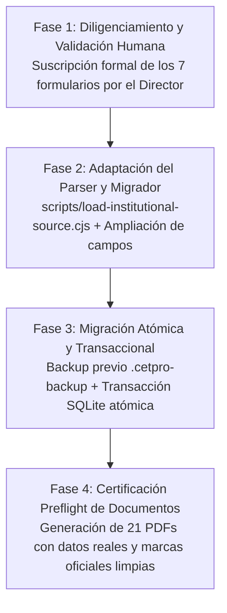

# INFORME EJECUTIVO DE HALLAZGOS Y EVALUACIÓN DE CONFIGURABILIDAD — TAREA 44

**Documento:** INFORME_EJECUTIVO_HALLAZGOS_TAREA44.md  
**Fecha de emisión:** 29 de octubre de 2026  
**Proyecto:** CEPRO_MICAELA 2.0 — Sistema Académico Institucional  
**Institución Beneficiaria:** CETPRO Público "Micaela Bastidas Puyucawa" (San Miguel, San Román, Puno)  
**Autoría:** cepro-documentador (Memoria Persistente y Documentación)  
**Destinatario:** Director Orquestador de Ingeniería y Equipo Directivo del CETPRO  

---

## 1. Resumen Ejecutivo de la TAREA 44

### 1.1 Misión y Alcance
La **TAREA 44** tiene por objeto determinar con rigor técnico y normativo toda la información necesaria para configurar **CEPRO_MICAELA 2.0** con los datos institucionales reales del **CETPRO "Micaela Bastidas Puyucawa"** (distrito de San Miguel, provincia de San Román, departamento de Puno, bajo jurisdicción de la UGEL San Román y DRE Puno).

Para pasar de un entorno de homologación con datos sintéticos hacia una puesta en producción definitiva con validez legal, se requiere parametrizar la totalidad de la estructura institucional: autoridades, directorio de personal docente y administrativo, catálogo oficial de programas y especialidades bajo el Catálogo Nacional de la Oferta Formativa (CNOF), planes de estudio modulares, calendarios académicos, asignaciones de carga lectiva y criterios de evaluación normados por el Ministerio de Educación (MINEDU).

### 1.2 Expediente de Configuración Institucional
Para recolectar, subsanar y validar esta información sin ambigüedades, se estructuró un **Expediente de Configuración Institucional** compuesto por 8 instrumentos documentales normados:

| N° | Instrumento | Denominación Oficial | Archivo del Repositorio | Objetivo Técnico / Normativo |
| :---: | :--- | :--- | :--- | :--- |
| **01** | Formulario 01 | Datos Generales de la Institución y Autoridades | `01_DATOS_INSTITUCIONALES.md` | Captura de Código Modular (1027648), DRE Puno, UGEL San Román, R.D. institucional y directivos legales. |
| **02** | Formulario 02 | Catálogo Oficial de Programas y Estructura Curricular | `02_PROGRAMAS_CURRICULARES.md` | Registro de 6 programas CNOF, 528h/20cr por módulo, UDs y soporte nativo a las 7 UDs de Peluquería M2. |
| **03** | Formulario 03 | Directorio de Personal Directivo, Docente y Administrativo | `03_PERSONAL_DOCENTE.md` | Padrón formal de 15 integrantes, DNI, rol institucional, asignación y exclusividad directiva Ley 30512. |
| **04** | Formulario 04 | Calendario Académico, Periodos y Cronogramas | `04_CALENDARIO_HORARIOS.md` | Periodos 2026-I y 2026-II, Semanas de Gestión 1 a 6 y propuesta técnica de cronograma habilidoso día a día. |
| **05** | Formulario 05 | Reglas de Evaluación, Calificaciones y Asistencia | `05_REGLAS_EVALUACION.md` | Escala vigesimal (00-20), nota mínima 13, redondeo favorable $\ge 0.5$, recuperación 10-12 y DPI al 30%. |
| **06** | Formulario 06 | Configuración de Prácticas Preprofesionales (EFSRT) | `06_CONFIGURACION_EFSRT.md` | Parámetros de 192h/6cr modular y 384h anual, modalidades, centros de prácticas y rúbrica de 9 criterios = 20 pts. |
| **07** | Formulario 07 | Requisitos de Emisión de 21 Documentos Oficiales MINEDU | `07_DOCUMENTOS_OFICIALES.md` | Parámetros de emisión de 21 PDFs, trazabilidad de notas, adaptabilidad tipográfica y soporte a 7 UDs. |
| **08** | Documento 08 | Matriz Técnica de Configuración, Persistencia y Trazabilidad | `08_MATRIZ_TECNICA_CONFIGURACION.md` | Mapa integral de vinculación entre campos, SQLite WAL, endpoints REST, manifiestos JSON y código fuente. |

---

## 2. Hallazgos Críticos, Inconsistencias y Contradicciones del Consolidado 2026

A partir del análisis forense de los documentos de trabajo preliminares (denominados *Consolidado 2026* y fuentes históricas legadas), se han detectado graves inconsistencias que impiden una carga directa y requieren rectificación formal mediante los formularios del expediente:

### 2.1 Inconsistencias Curriculares Graves de Horas y Créditos

La normativa nacional de la Educación Técnico-Productiva (RVM N° 188-2020-MINEDU y RVM N° 176-2021-MINEDU) establece para el nivel de **Auxiliar Técnico**:
- **Duración total:** 40 créditos académicos y un mínimo de 950 a 1,000 horas lectivas (típicamente 1,056 horas anuales distribuidas en 2 módulos de 20 créditos y 528 horas cada uno).
- **Equivalencia de créditos:** 
  * 1 crédito teórico = 16 horas lectivas.
  * 1 crédito práctico = 32 horas lectivas.

Frente a esta regla estricta, los planes del Consolidado 2026 presentan las siguientes desviaciones críticas:

| Programa | Declaración Consolidado 2026 | Norma MINEDU Canónica | Estado / Desviación |
| :--- | :--- | :--- | :--- |
| **Peluquería y Barbería (M1)** | 23 Créditos / 608 Horas | 20 Créditos / 528 Horas | **Exceso de 3 créditos y 80 horas** |
| **Peluquería y Barbería (M2)** | 24 Créditos / 656 Horas | 20 Créditos / 528 Horas | **Exceso de 4 créditos y 128 horas** |
| **Electricidad y Electrónica** | M1: 24 Cr / M2: 16 Cr | M1: 20 Cr / M2: 20 Cr | **Desbalance de 4 créditos entre módulos** |
| **Corte y Ensamblaje** | M1: 544 h / M2: 544 h (Total: 1,088 h) | M1: 528 h / M2: 528 h (Total: 1,056 h) | **Exceso de 16 h por módulo (32 h anuales)** |
| **Mecánica Automotriz (M2)** | M2 suma 496 Horas | M2: 528 Horas | **Déficit de 32 horas** |

1. **Peluquería y Barbería:**
   - **Módulo 1:** Declara 23 créditos y 608 horas (exceso de 3 créditos y 80 horas). Además, en la UD 1 (*Bioseguridad y Diagnóstico Capilar*) se declaran 2 créditos con 16 horas teóricas y 16 horas prácticas; según la regla MINEDU (16 HT = 1 crédito; 32 HP = 1 crédito), 16 HP equivalen a 0.5 créditos, por lo que la unidad suma 1.5 créditos y no 2 créditos.
   - **Módulo 2:** Declara 24 créditos y 656 horas (exceso de 4 créditos y 128 horas). La suma total anual llega a 47 créditos y 1,264 horas, desbordando el marco formativo de Auxiliar Técnico.
2. **Sistemas Eléctricos / Electricidad y Electrónica:**
   - **Desbalance modular:** El Módulo 1 declara 24 créditos y el Módulo 2 declara 16 créditos. Si bien la suma nominal da 40 créditos, existe un desbalance de 4 créditos entre módulos que distorsiona las cargas de matrícula por periodo.
   - **Omisión de desglose:** No se detallan las horas específicas teóricas y prácticas asignadas a cada Unidad Didáctica, imposibilitando el preflight de actas oficiales.
3. **Corte y Ensamblaje / Confección Textil:**
   - **Exceso horario:** Cada módulo suma 544 horas en lugar de las 528 horas normadas, generando un exceso de 16 horas por módulo (1,088 horas anuales en total).
   - **Conflicto de denominación:** En el directorio docente la plaza aparece como *"Confección Textil"*, mientras que en el catálogo y planes aparece como *"Corte y Ensamblaje"*.
4. **Mecánica Automotriz vs. Mecánica de Motos:**
   - **Déficit horario:** El Módulo 2 de Mecánica Automotriz suma 496 horas, faltando 32 horas para completar las 528 horas reglamentarias.
   - **Discrepancia de especialidad docente:** En el directorio figuran dos docentes con perfiles diferenciados: uno en *Mecánica Automotriz* y otro en *Mantenimiento de Motos*, pero en el Consolidado 2026 solo se registró el plan de estudios automotriz, omitiéndose el plan formal de motocicletas.

---

### 2.2 Inconsistencias de Calendario Académico y Propuesta de Cronograma Hábil
1. **Fechas en Fines de Semana en Borradores Previos:** En el borrador histórico de Computación e Informática figuraban fechas de inicio y término en sábados y domingos.
2. **Vacío Calendárico Injustificado en Módulo 2:** Entre el término de la UD 3 (21 de octubre) y el inicio de la UD 4 (28 de octubre) existía una brecha de 6 días vacíos sin actividad lectiva ni justificación curricular.
3. **Superposición de EFSRT con Clases Teóricas:** El borrador situaba las prácticas EFSRT en paralelo desordenado con unidades presenciales.
4. **Ausencia Total de Fechas en 5 Programas:** Los otros 5 programas (Peluquería, Confección, Automotriz, Carpintería Metálica y Electricidad) carecen de fechas específicas de unidades en las fuentes legadas.
5. **Propuesta Técnica de Cronograma Habilidoso (Computación e Informática M2):**  
   Para subsanar estas fallas, se formuló una **Propuesta Técnica de Cronograma Habilidoso** (debidamente rotulada para validación y firma de Dirección y Secretaría en el Formulario 04):
   - **UD 1 (Soporte Técnico de Equipos de Cómputo):** 10/08/2026 al 04/09/2026 (96h, 4 semanas = 20 días hábiles de lunes a viernes).
   - **UD 2 (Redes de Comunicación de Datos):** 07/09/2026 al 02/10/2026 (96h, 4 semanas = 20 días hábiles continuos, iniciando en lunes).
   - **UD 3 (Administración y Configuración de Servidores):** 05/10/2026 al 16/10/2026 (48h, 2 semanas = 10 días hábiles; feriado 08/10 Combate de Angamos compensado en jornada técnica de taller).
   - **UD 4 (Diseño e Implementación de Sitios Web):** 19/10/2026 al 30/10/2026 (48h, 2 semanas = 10 días hábiles continuos; **subsana y cierra el vacío de 6 días**).
   - **UD 5 (Seguridad Informática y Protección de Datos):** 02/11/2026 al 13/11/2026 (48h, 2 semanas = 10 días hábiles; inicia tras feriado del 01/11 Todos los Santos).
   - **EFSRT II (Prácticas Preprofesionales Módulo II):** 16/11/2026 al 18/12/2026 (192h, 5 semanas = 25 días hábiles a jornada intensiva o en contraturno, concluyendo junto al cierre lectivo).

---

### 2.3 Inconsistencias en el Directorio de Personal
1. **Omisión Sistemática de Fechas de Nacimiento:** En los 15 registros de directivos, docentes y administrativos del consolidado, se omitió el año de nacimiento (registrando únicamente día y mes, ej. "14 de mayo"), dato indispensable para el registro único de personal y emisión de contratos/credenciales.
2. **Domicilios Incompletos o Faltantes:** Varios docentes no consignan domicilio fiscal o registran únicamente referencias genéricas sin numeración ni distrito.
3. **Falta de Asignación Modular Específica:** En programas donde existen dos o tres docentes contratados para la misma carrera (como en Peluquería o Computación), no se especifica qué docente asume cada módulo o turno, lo cual bloquea la configuración del control de acceso RBAC.
4. **Carga Directiva Exclusiva:** Según la Ley N° 30512 y su R.D. de designación, el Director Lic. Eloy Valerio Paredes Feliciano ejerce dedicación directiva institucional exclusiva (40 horas semanales de gestión), no asumiendo carga lectiva de aula, siendo asumida la docencia de Electricidad al 100% (30h/sem) por el Prof. Huanca Castro.

---

### 2.4 Solución Técnica Homologada para las 7 UDs de Peluquería y Barbería Módulo II
- **Diagnóstico Curricular:** El CETPRO "Micaela Bastidas Puyucawa" aprobó formalmente su plan curricular del Módulo II de Peluquería y Barbería con **7 Unidades Didácticas (UD 1 a UD 7: Tratamiento Capilar)**.
- **Principio Rector:** **El software debe adaptarse fielmente a la estructura pedagógica de la institución y no forzar recortes arbitrarios.**
- **Solución Implementada en CEPRO_MICAELA 2.0:**
  1. **Evaluación de Aprendizajes:** Totalmente homologada mediante la plantilla oficial MINEDU `TMPL-17` (`17_EVALUACION_UD7.json`), que registra capacidades, indicadores de logro IL1..IL5 y promedios de la 7ma UD.
  2. **Control de Asistencia:** El sistema provee soporte nativo mediante la plantilla complementaria `TMPL-05_EXT` (extensión de asistencia técnica), que toma la estructura geométrica de `05_ASISTENCIA_UD1.json` y la extiende para la 7ma unidad didáctica, garantizando la captura de sesiones, inasistencias y alertas de DPI (30%) para *Tratamiento Capilar*.
  3. **Preservación Integral:** No se requiere fusionar ni suprimir la 7ma unidad; el software opera las 7 UDs respetando la autonomía y legalidad del plan institucional.

---

## 3. Evaluación de Configurabilidad Actual de CEPRO_MICAELA 2.0

Se evaluó la capacidad del sistema para adaptarse a los datos institucionales sin requerir reconstrucciones de binarios ejecutables, verificando directamente el código fuente y las pruebas automatizadas del proyecto:

### 3.1 Arquitectura de Persistencia y Seguridad Local (`scripts/offline-core.cjs`)
CEPRO_MICAELA 2.0 opera sobre **Node.js 24 nativo con SQLite (`DatabaseSync`)** bajo un modelo transaccional de alta resiliencia y cero dependencias externas:
- **Modo Write-Ahead Logging (WAL):** Configurado mediante `PRAGMA journal_mode = WAL;` y `PRAGMA synchronous = NORMAL;`, asegurando persistencia ACID resistente a cortes de energía en la sede institucional de San Miguel.
- **Tabla `settings`:** Almacena parámetros globales institucionales y reglas de evaluación bajo pares clave-valor fuertemente tipados.
- **Tabla `records`:** Almacena las entidades académicas (programas, módulos, periodos, grupos, estudiantes, matrículas, notas y asistencias) en formato JSON indexado con control de concurrencia optimista (`rev`), detectando ediciones concurrentes y respondiendo con HTTP `409 Conflict`.
- **Segregación de Roles (RBAC):** La función `core.requireRole(actor, allowedRoles)` gobierna el acceso estricto de los perfiles `DIRECTOR`, `SECRETARIA`, `DOCENTE` y `SERVICIO`.

### 3.2 Módulos de Software de Configurabilidad y Funciones Centrales

1. **Gestión Documental React (`src/pages/ConfiguracionDocumental.tsx`):**
   - Implementa la interfaz de usuario con 10 ámbitos parametrizables: `institution`, `program`, `module`, `group`, `unit`, `unitCurriculum`, `enrollment`, `registry`, `practice` y `closure`.
   - Permite a Dirección y Secretaría ajustar en tiempo real datos de la institución, fechas de expedición, resoluciones y capacidades pedagógicas.
   - Cuenta con candados visuales y protección de cambios en tránsito con `PendingChangesContext`.

2. **Motor de Reglas y Configuración Académica (`scripts/academic-config.cjs`):**
   - `schema`: Especificación formal de tipos de datos, roles autorizados y restricciones por ámbito.
   - `validate(core, scope, fields)`: Validador semántico que exige el formato canónico de años (4 dígitos), códigos modulares, integridad referencial y presencia obligatoria de unidades `UD1..UDn` y `EFSRT`.
   - `configuration(core, actor)`: Retorna el catálogo institucional y diagnósticos preventivos a la interfaz.
   - `cloneYear(core, actor, input)`: Operación transaccional atómica que migra el árbol curricular hacia un nuevo ciclo anual (ej. de 2026 a 2027), creando identificadores nuevos e inmutabilizando el histórico académico.
   - `issues(core, year)`: Algoritmo de diagnóstico que audita discrepancias en la suma de horas y créditos contra el total declarado del módulo, detectando fechas vacías o turnos pendientes.
   - `parse(v)` y `synchronize(core, actor, saved)`: Deserialización segura y sincronización reactiva de nombres y calendarios en todo el árbol de tablas.

3. **Catálogo de Contratos Oficiales (`scripts/document-contracts.cjs`):**
   - Define el diccionario normativo `SETTINGS_FIELDS`, la inyección paramétrica `TEMPLATE_PARAMETERS` para los 21 formatos (`TMPL-01` a `TMPL-21`), las denominaciones oficiales `NAMES` y la compilación en memoria `catalog(root)`.

4. **Endpoints REST del Servidor Local Express:**
   - `GET/PUT /api/settings`: Parámetros institucionales.
   - `GET/PUT /api/academic/*`: Catálogo modular, planes y calendarios.
   - `GET/PUT /api/teachers/*`: Padrón docente y asignaciones.
   - `GET/POST /api/records/*`: Generación de documentos oficiales y validación SHA-256.
   - `GET/POST /api/document/configuration`: Consulta y persistencia por ámbito documental.

5. **Aseguramiento de Calidad y Pruebas Automatizadas:**
   - Verificado mediante la ejecución íntegra de **219 pruebas automatizadas en 22 suites** (`scripts/run-qa-tests.cjs`), que acreditan cálculos ponderados, omisiones automáticas de formatos vacíos y transaccionalidad atómica.
   - Verificación de higiene del bundle empaquetado (`tests/institutional-bundle-clean.test.cjs`), certificando que el release institucional carece de credenciales de prueba, rutas relativas sandbox o marcas de prototipo.

---

## 4. Propuesta de Integración de Datos Oficiales

Para asegurar una transición limpia, segura y jurídicamente respaldada desde los datos sintéticos actuales hacia los datos reales del CETPRO, se establece un protocolo de cuatro fases consecutivas:

### Fase 1: Validación y Firma Humana de Formularios
- Entrega física y digital de los 7 formularios del expediente al Director del CETPRO, **Lic. Eloy Valerio Paredes Feliciano**.
- Subsanación colegiada de las inconsistencias horarias de Peluquería, Electricidad, Confección y Mecánica.
- Suscripción del **Documento 08 (Acta de Validación y Conformidad Institucional)** debidamente sellada y firmada.

### Fase 2: Adaptación del Parser e Ingestor de Datos
- Actualización de `scripts/load-institutional-source.cjs` para procesar directamente las tablas estructuradas en Markdown o CSV provenientes de los formularios devueltos.
- Ampliación del esquema de metadatos en backend para soportar los 5 campos institucionales adicionales detectados en la auditoría (Resolución Directoral de Revalidación, Turno por Grupo, Código de Plaza Docente, Modalidad Presencial/Semipresencial y Nivel CNOF).

### Fase 3: Migración Atómica y Transaccional en SQLite
- Generación previa obligatoria de una copia de respaldo cifrada `.cetpro-backup` del nodo antes de cualquier mutación.
- Ejecución de la migración bajo una **transacción única atómica** en `node:sqlite` (`BEGIN TRANSACTION ... COMMIT`). Si se detecta un error de integridad o crédito descuadrado, se ejecuta un `ROLLBACK` automático dejando la base intacta.

### Fase 4: Checklist Preflight sobre los 21 Formatos Normados
- Ejecución del arnés de preflight sobre las 21 plantillas MINEDU.
- Verificación de que los 21 documentos oficiales se generan con:
  * Encabezados con el nombre legal exacto: *CETPRO Público "Micaela Bastidas Puyucawa"*.
  * Autoridades oficiales: Lic. Eloy Valerio Paredes Feliciano (Director).
  * Ausencia total de leyendas "BORRADOR" o marcas de prototipo al contar con planes completos.
  * Cálculos automáticos de promedios vigesimales y convalidación de horas de EFSRT.

---
**Dictamen Final de Documentación:** Se declara concluido el diagnóstico de requerimientos institucionales de la TAREA 44. El Expediente de Configuración Institucional queda estructurado y listo para su remisión y suscripción por las autoridades del CETPRO.
